<!--
manual-meta
titulo: Manual técnico — PDV (Punto de Venta)
lead: Descripción funcional, arquitectura, requerimientos de instalación, diagramas UML y de base de datos, y guías de diagnóstico, mantenimiento y evolución.
actualizado: 2026-10-26
chips: Partes 1-37 mergeadas | Partes 38-40 implementadas | Backend 226 tests | Android 516 tests | Alembic 0001-0015 | Room v11 | Release 1.0.0
-->
# Manual técnico — PDV (Punto de Venta)

Documento de referencia para el equipo de *application management*: descripción
funcional, arquitectura, requerimientos de instalación, diagramas UML y de base
de datos, y guías de diagnóstico, mantenimiento y evolución.

- **Código de proyecto**: `POS` (Jira) / `PDV` (repo).
- **Estado a la fecha de este manual (2026-10-26)**: Partes 1-37
  implementadas y mergeadas (la 36 en PR #46, merge `679664e`; la 37 en PR
  #47, merge `871e8a8`), incluyendo el motor de sincronización diferida
  (Parte 32), este propio manual (Parte 33), la convergencia del inventario
  en el sync (Parte 34), la de catálogo y ubicación (Parte 35), la de
  sucursal estable y rechazos visibles (Parte 36) y el endurecimiento de
  seguridad pre-release (Parte 37; épica `POS-172`, historias
  `POS-173`..`POS-175`). La Parte 38 (integridad de datos del backend; épica
  `POS-177`, historias `POS-178`..`POS-180`) está implementada en la rama
  `feature/POS-177-integridad-datos` (commit `da5cabc`), aún sin mergear a
  `main`, y sigue listada en `docs/PLAN.md`. La Parte 39 (calidad y deuda menor
  pre-release; épica `POS-181`, historias `POS-182`..`POS-185`) está
  implementada en la rama `feature/POS-181-calidad-deuda-menor` (commit
  `9706649`), pendiente de merge. La Parte 40 (primer release: APK firmado
  y ofuscado `1.0.0`; épica `POS-186`, historias `POS-187`..`POS-193`) está
  implementada en la rama `feature/POS-186-primer-release` (commit
  `d3a4cd2`), pendiente de merge; el backend productivo y la prueba en un
  segundo dispositivo quedaron diferidos al Backlog. Las Partes 36-40 salen
  de la revisión pre-release de `docs/review_code.md`. App corriendo en
  dispositivo físico contra backend dockerizado en LAN.
- **Fuentes de verdad vivas** (este manual las resume, no las reemplaza):
  - `CLAUDE.md` — arquitectura estable, convenciones, comandos.
  - `docs/api-contract.md` — contrato de endpoints REST.
  - `docs/schema-pos.json` — esquema de datos compartido (Room + Alembic).
  - `docs/PLAN.md` — trabajo en curso y pendiente (Partes 38-40 implementadas + Backlog).
  - `docs/PLAN-historico.md` — bitácora cerrada de las Partes 1-33 (la 34, la
    35, la 36 y la 37, ya mergeadas, siguen en `docs/PLAN.md` hasta archivarse).
  - `docs/review_code.md` — revisión pre-release del 2026-09-28/29 (origen de
    las Partes 34 y 36-40). La revisión anterior (2026-08-30, origen de las Partes
    21-30) se archivó como `docs/review_code_2026-09-28_1816.md`.
  - `docs/ALCANCE-DOCS.md` — manifiesto de alcance de este manual y de sus
    derivados HTML/PDF, mantenidos con `/docs-sync` ([§10.7](#107-comandos-slash-del-proyecto)).

---

## Índice

1. [Descripción funcional](#1-descripción-funcional)
2. [Arquitectura](#2-arquitectura)
3. [Modelo de datos (ER)](#3-modelo-de-datos-er)
4. [Diagramas UML](#4-diagramas-uml)
5. [Requerimientos e instalación](#5-requerimientos-e-instalación)
6. [Configuración](#6-configuración)
7. [Seguridad](#7-seguridad)
8. [Referencia de API](#8-referencia-de-api)
9. [Operación y diagnóstico](#9-operación-y-diagnóstico)
10. [Mantenimiento](#10-mantenimiento)
11. [Evolución y deuda técnica conocida](#11-evolución-y-deuda-técnica-conocida)
12. [Glosario](#12-glosario)

---

## 1. Descripción funcional

PDV es una aplicación de punto de venta para comercios con varias sucursales.
Funciona **completamente offline** (Kotlin + Room) y puede **sincronizarse**
de forma diferida con un backend FastAPI compartido entre sucursales. Incluye
un **asistente de IA opcional** (DeepSeek / OpenAI / OpenRouter) para consultas
y actualizaciones asistidas.

### 1.1 Módulos

| Módulo | Pantalla(s) | Qué hace | Persistencia |
|---|---|---|---|
| **Login / Sesión** | `LoginScreen`, `PanelConexionBottomSheet`, `CambiarPasswordScreen` | Autenticación por usuario/contraseña; panel de conexión accesible sin sesión (cambiar modo LOCAL/REMOTO, esquema/host/puerto, "Probar conexión"). Si la sesión trae `debeCambiarPassword` (admin de arranque con `admin123`), `MainActivity` muestra `CambiarPasswordScreen` en lugar de la navegación hasta que se cambie la contraseña (Parte 37). Muestra el logo horizontal de MiPE (versión clara u oscura según el tema). La sesión expira tras 12 horas en segundo plano: al volver a la app o al arrancar el proceso se muestra el login (Parte 40, M-5; ver [§7](#7-seguridad)). | Sesión en memoria (`SessionManager`) más `SessionStore` cifrado (incluye `session_ultimo_uso`); conexión en DataStore. |
| **Venta de mostrador** | `VentaScreen` | Alta de venta con líneas, escaneo de código de barras (CameraX + ML Kit), método de pago efectivo/tarjeta, cálculo de cambio, ticket PDF e impresión. Decrementa inventario y genera movimiento de salida. | `ventas`, `venta_detalle`, `inventario`, `movimientos`. |
| **Entrada de mercancía** | `EntradaScreen` | Recepción de mercancía de artículo existente o alta de artículo nuevo. Incrementa inventario (delta aditivo) y genera movimiento de entrada. | `movimientos` (tipo `entrada`), `articulos`, `inventario`. |
| **Inventario** | `InventarioScreen`, `ImportarCatalogoScreen` | Consulta paginada con búsqueda (nombre/SKU/código de barras), ajuste de atributos de catálogo + existencia (genera movimiento de ajuste con delta), exportación CSV/Excel, importación de catálogo desde CSV (`InventarioCsvImporter` quita el BOM UTF-8 del encabezado, Parte 40). | `articulos`, `inventario`, `movimientos`. |
| **Caja** | `CajaScreen` | Cortes de caja parciales y finales, retiros de efectivo, cálculo de totales del periodo (ventas, efectivo, tarjeta, retiros, monto esperado), exportación por periodo. | `cortes_caja`, `retiros_efectivo`. |
| **Devoluciones** | `DevolucionScreen` | Registro de devolución de cliente con líneas (motivo, condición). No toca inventario (gestión con proveedor). | `devoluciones`, `devolucion_detalle`. |
| **Usuarios** | `UsuarioScreen` | CRUD de usuarios, asignación de rol (selector vertical `SelectorRadio`), alta/cambio de contraseña (hash bcrypt calculado en el dispositivo). | `usuarios`. |
| **Roles** | `RolScreen` | CRUD de roles personalizados; `modulos_permitidos` activa/desactiva pantallas completas. Dos roles de sistema no editables (`administrador`, `encargado_turno`). | `roles`. |
| **Configuración** | `ConfiguracionScreen` | `BackendMode` (selector vertical `SelectorRadio`, igual que en el panel de conexión del login; reemplaza los botones segmentados que cortaban palabras, Parte 39), parámetros de conexión remota, sucursal seleccionada, activación y token del asistente de IA, prompt de sistema editable. Encender la IA abre un diálogo de consentimiento (qué datos se envían al proveedor: mensaje e historial, resumen de inventario, totales de caja del día); sin aceptarlo el switch queda apagado, y apagarlo persiste al momento y retira el consentimiento (Parte 40, A-7). En LOCAL también se persiste la sucursal por defecto (Parte 40). En `LOCAL_CON_SINCRONIZACION`: sección "Sincronización" (última sync, pendientes, último error, botón "Sincronizar ahora") la cuenta "Rechazadas por el backend: N (ver Conflictos)" (Parte 36) y confirmación de pendientes al cambiar de modo (Parte 32). Si la sucursal guardada no aparece en el catálogo emitido, la conserva y muestra un aviso para que el usuario elija (Parte 36). | DataStore (preferencia de dispositivo); token cifrado con Android Keystore. |
| **Pantalla principal / Acerca de** | `HelloScreen`, `AcercaDeScreen` | La pantalla principal (`HelloViewModel`, `HelloUiState`) muestra un encabezado de turno: nombre de la sucursal seleccionada (o "Sin sucursal seleccionada"), usuario en turno con su rol y el `EstadoConexion` (`SOLO_LOCAL`, `COMPROBANDO`, `CONECTADO`, `SIN_CONEXION`); fuera de LOCAL consulta `/health` y solo distingue si hubo `IOException`. `AcercaDeScreen` (ruta `ACERCA_DE`, botón "Acerca de") muestra el logo con eslogan, versión y `versionCode` (de `BuildConfig`), fecha, novedades, "Limitaciones conocidas" (cantidades enteras y sin IVA desglosado, M-8), equipo y contacto (de `res/values/strings.xml`, vía `InfoRelease`/`di/AcercaDeModule`); fecha, novedades y limitaciones se editan a mano en cada release. El nombre visible de la app es "MiPE PDV" (`app_name`; `applicationId` `com.pdv.pos` sin cambio). | `BuildConfig` y recursos; sin persistencia. |
| **Revisión de conflictos** | `RevisionConflictosScreen` | Panel **solo lectura** de `sync_conflicts`: lista los conflictos de sincronización detectados y su resolución automática. | `sync_conflicts`. |
| **Asistente de IA + FAQ** | `AsistenteIaWidget` (overlay flotante) | Chat con LLM; responde consultas, ejecuta acciones (alta de artículo, corte parcial, retiro, devolución, exportar/consultar inventario) por los **mismos repositorios** que las pantallas manuales, con confirmación explícita y chequeo de permiso. FAQ curado con retrieval de 3 niveles y atajos sin conexión (`qN`, match de texto). | Reutiliza los repositorios de dominio; FAQ empaquetado (`faq.jsonl`). |
| **Logs / Auditoría** | — (sin pantalla) | `AppLogger` escribe archivos `.txt` locales al dispositivo, una línea por evento con `[tipo][timestamp][sucursal][usuario] mensaje`. Categorías: `ERROR`, `WARN`, `INFO`, `DB_WRITE`, `SYNC_CONFLICT`, `AUTH`. Rotación a 5 MB, retención 30 días (la purga corre solo al rotar). | Sistema de archivos del dispositivo (`filesDir`). |

### 1.2 Modos de backend (`BackendMode`)

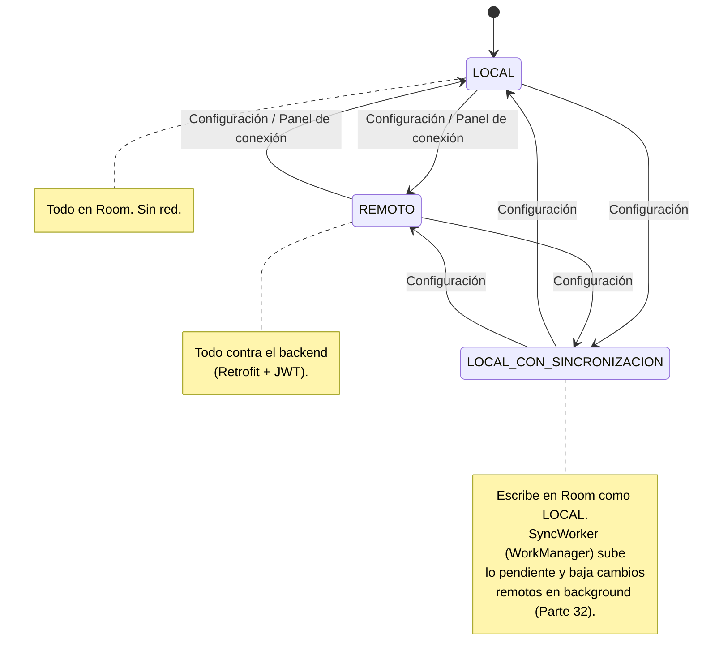

- **LOCAL**: la app opera 100% contra Room. No hay tráfico de red de negocio.
- **REMOTO**: cada operación va contra el backend por HTTP con
  `Authorization: Bearer <JWT>`. La respuesta del servidor es la fuente de verdad.
- **LOCAL_CON_SINCRONIZACION**: escribe en Room igual que LOCAL; el catálogo de
  sucursales se lee del backend en modo *best-effort* (degrada al catálogo local
  si falla). Un `SyncWorker` en background (periódico + botón "Sincronizar
  ahora") sube lo creado offline y baja los cambios remotos de entidades
  transaccionales, reusando la idempotencia por `local_id` de la Parte 23
  para no duplicar (detalle en [§2.4](#24-motor-de-sincronización)).

---

## 2. Arquitectura

### 2.1 Vista de contexto / despliegue

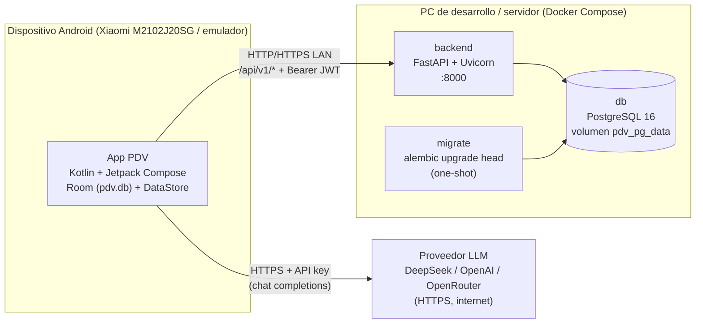

- El dispositivo alcanza el backend por **Wi-Fi en la misma subred** (IP LAN de
  la PC + puerto 8000) o, como alternativa, por **USB con `adb reverse`**
  (`localhost:8000`).
- El backend se publica en `0.0.0.0:8000` dentro del contenedor; el acceso
  desde otros equipos de la LAN requiere una regla de firewall inbound
  (ver [§5](#5-requerimientos-e-instalación)).
- El asistente de IA llama directo al proveedor LLM desde el dispositivo; el
  backend no interviene en ese camino.

### 2.2 App Android — capas

Arquitectura **MVVM + offline-first** con separación estricta
`domain / data.local / data.remote`. Paquete raíz `com.pdv.pos`.

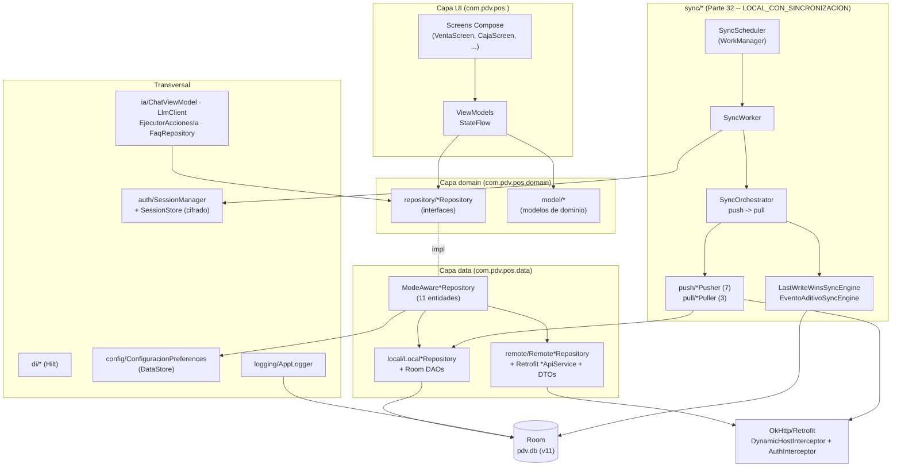

**Reglas de arquitectura (obligatorias, ver `CLAUDE.md` §3):**

1. `domain/` no conoce Room ni Retrofit: los ViewModels dependen solo de las
   interfaces `*Repository`.
2. `data/local/` **no importa nada de `data/remote/`**. El modo LOCAL debe
   compilar y funcionar aislado de la red.
3. La implementación inyectada de cada `*Repository` es siempre el
   `ModeAware*Repository`, que resuelve local vs. remoto leyendo `BackendMode`
   de DataStore en cada llamada.
4. Nunca se lanzan excepciones sin capturar desde la capa de red: se usa
   `ApiResult.Success/Error` o `Result<T>`. `ModeAwareAuthRepository` captura
   solo `IOException` y `HttpException` (no `runCatching`), de modo que la
   cancelación de corrutinas se propaga (Parte 39).
5. `BackendMode`, parámetros de conexión y sucursal seleccionada son
   preferencia de dispositivo y viven en DataStore, **sin Room** (excepción
   documentada). El catálogo de sucursales sí sigue el patrón repositorio/Room.

**Patrón `ModeAware*` (ejemplo real, `ModeAwareVentaRepository`):**

```kotlin
override suspend fun registrarVenta(venta: Venta) {
    when (preferences.deviceConfig.first().backendMode) {
        BackendMode.LOCAL, BackendMode.LOCAL_CON_SINCRONIZACION -> local.registrarVenta(venta)
        BackendMode.REMOTO -> remote.registrarVenta(venta)
    }
    inventarioRefreshSignal.emitir()
}
```

**Stack Android** (`android/gradle/libs.versions.toml`):

| Área | Tecnología | Versión |
|---|---|---|
| Lenguaje / build | Kotlin / AGP / KSP | 2.2.21 / 8.13.2 / 2.2.21-2.0.5 |
| SDK | compileSdk / targetSdk / minSdk | 36 / 36 / 26 (Android 8.0) |
| UI | Jetpack Compose BOM · Material3 · Navigation-Compose | 2026.06.01 · — · 2.9.6 |
| DI | Hilt | 2.57.2 |
| Sync en background | WorkManager · Hilt-Work (Parte 32) | 2.10.1 · 1.2.0 |
| Red | Retrofit · OkHttp · kotlinx.serialization | 3.0.0 · 5.4.0 · 1.11.0 |
| Persistencia local | Room · DataStore Preferences | 2.8.4 · 1.2.1 |
| Arranque (Parte 40) | `androidx.core:core-splashscreen` | 1.2.0 |
| Escaneo | CameraX · ML Kit barcode-scanning | 1.6.1 · 17.3.0 |
| Cripto | bcrypt (at.favre.lib) | 0.10.2 |
| Test (JVM) | JUnit5 · MockK · kotlinx-coroutines-test · OkHttp MockWebServer | 6.1.3 · 1.14.11 · 1.11.0 · 5.4.0 |
| Test (instrumentado, Parte 39) | `room-testing` (misma versión de Room) · `androidx.test:runner` · `androidx.test.ext:junit` | 2.8.4 · 1.7.0 · 1.3.0 |
| JVM target | 17 | |

### 2.3 Backend FastAPI — capas

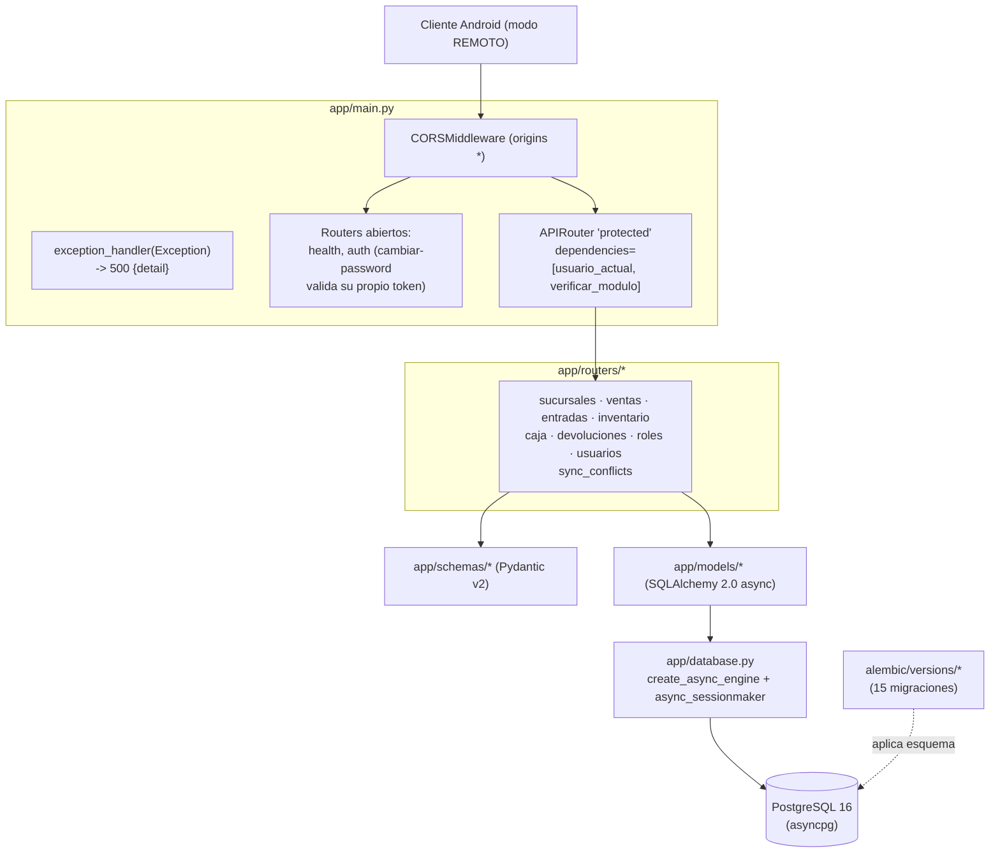

- **Autenticación y autorización** se declaran **una sola vez** a nivel del
  router `protected` (`app/main.py`): `Depends(usuario_actual)` valida el JWT y
  carga el `Usuario` (con su `rol` vía `selectinload`); `Depends(verificar_modulo)`
  aplica el chequeo de módulo a las escrituras. Desde la Parte 37
  (`app/dependencies.py`) `usuario_del_token` hace la validación del JWT y
  `usuario_actual` la envuelve para devolver `403 {"detail": "debe cambiar la
  contrasena"}` mientras `Usuario.debe_cambiar_password` esté encendida.
- `health` y `auth` quedan fuera del router protegido (rutas abiertas):
  `POST /auth/cambiar-password` usa directamente `usuario_del_token`, por lo
  que es la única ruta que acepta el token de un usuario con la marca
  encendida.
- **Configuración y arranque** (`app/config.py`, Parte 37): `PDV_ENV` (sin
  valor se asume `production`, falla cerrado) y `JWT_SECRET_KEY` obligatoria
  (el proceso no arranca sin ella, ni con el valor de desarrollo fuera de
  `PDV_ENV=development`). `opciones_docs` deja `/docs`, `/redoc` y
  `/openapi.json` solo en `development`.
- **Atribución y validación de escrituras** (Parte 38,
  `docs/api-contract.md` §12): `usuario_id` de ventas, movimientos (entradas y
  ajustes, 7.2 y 7.4), `cortes_caja`, `retiros_efectivo` y `devoluciones` lo
  fija el servidor con `str(usuario.id)` de `Depends(usuario_actual)`; los
  schemas de entrada ya no traen `usuario_id` y aceptan `usuario_dispositivo`
  (`UsuarioDispositivo`, `app/schemas/comunes.py`, máx. 120 caracteres, `422`
  si se excede), columna informativa nullable agregada por Alembic `0015`.
  `PATCH /articulos/{articulo_id}` (7.5) ya no recibe usuario. Un
  `model_validator` en `VentaCreateSchema` (por línea `cantidad *
  precio_unitario == subtotal`, `Σ subtotales == subtotal`, `total == subtotal
  - descuento + impuestos`) y en `CorteCajaCreateSchema` (fechas, totales y
  diferencia coherentes) compara con el helper `a_centavos` (2 decimales,
  `ROUND_HALF_UP`) y responde `422`. `app/inventario_bloqueo.py`
  (`bloquear_inventario`) hace `INSERT ... ON CONFLICT DO NOTHING` sobre
  `uq_inventario_sucursal_articulo` seguido de `SELECT ... FOR UPDATE`; lo usan
  ventas, entradas y `POST /ajustes-inventario`, de modo que el primer insert
  concurrente de una fila de inventario ya no da `500`. `POST /devoluciones`
  valida los artículos con una sola query `IN` y su `estado` es
  `Literal["registrada", "en_gestion_proveedor", "cerrada"]`.
- **Límite de intentos de login** (`app/limite_login.py`): contador en
  memoria por `username`, 5 fallos en 15 minutos bloquean ese username con
  `429` (por worker, se pierde al reiniciar).
- El `exception_handler` global convierte cualquier excepción no prevista en
  `500 {"detail": "error interno del servidor"}` y la loguea a nivel `ERROR`
  (sin traceback al cliente). No intercepta `HTTPException` ni `422`.
- **Sin ORM como response_model**: los routers devuelven esquemas Pydantic de
  `app/schemas/`.
- **Montos y cantidades** viajan como *string JSON* en el contrato para no
  perder precisión decimal; en Postgres son `Numeric(12,2)` / `Numeric(14,3)`.

**Stack backend** (`backend/pyproject.toml`, `uv.lock`):

| Área | Tecnología | Versión |
|---|---|---|
| Runtime | Python | >=3.11 (3.11.15 gestionado por uv) |
| Framework | FastAPI · Uvicorn[standard] | 0.141.1 · 0.52.4 |
| ORM / migraciones | SQLAlchemy 2.0 (async) · Alembic | 2.0.52 · 1.19.1 |
| Driver DB | asyncpg | 0.31.0 |
| Cripto / auth | bcrypt · PyJWT | 5.0.0 · 2.13.0 |
| Gestor de dependencias | uv | 0.10.12 |
| Test | pytest · pytest-asyncio · httpx | 9.1.1 · 1.4.0 · 0.28.1 |
| Base de datos | PostgreSQL | 16 |

### 2.4 Motor de sincronización

Diseño *last-write-wins* + eventos aditivos (`android/.../sync/`,
`docs/PLAN.md` Parte 6, `docs/api-contract.md` §12).

- **Entidades sin ambigüedad de cantidad** (precios, usuarios, roles,
  sucursales): `LastWriteWinsResolver` compara `updated_at`; gana el más
  reciente.
- **Entidades de cantidad/movimiento** (inventario, ventas, cortes, devoluciones):
  `EventoAditivoCombiner.combinar(base, deltaLocal, deltaRemoto)` — nunca un
  `UPDATE cantidad = X` directo, siempre suma de deltas con signo. El backend
  aplica el mismo principio (`inventario.cantidad = cantidad_actual ± delta`,
  con `FOR UPDATE` vía `bloquear_inventario` para evitar carreras).
- **Auditoría**: toda divergencia de `updated_at` se registra en
  `sync_conflicts` (aunque se resuelva automáticamente) y se loguea con
  `LogType.SYNC_CONFLICT`.
- **Idempotencia de los POST de sync** (Parte 23 + gap 1 de la Parte 32):
  `ventas`, `movimientos` (entradas), `cortes_caja`, `retiros_efectivo` y
  `devoluciones` tienen `UNIQUE(local_id)`; el router hace `flush()`, captura
  `IntegrityError`, hace `rollback` y devuelve `200` con la fila ya persistida
  en vez de duplicar. `sync_conflicts` es idempotente por su `id` generado en
  el dispositivo.
- **Orquestación del push/pull en background** (`android/.../sync/push/`,
  `sync/pull/`, Parte 32): `SyncScheduler` encola un `SyncWorker`
  (`CoroutineWorker` + Hilt) periódico (~15 min, con `Constraints` de
  conectividad y backoff exponencial) más un `OneTimeWorkRequest` desde el
  botón "Sincronizar ahora" de Configuración — ambos no-op salvo
  `BackendMode == LOCAL_CON_SINCRONIZACION`. `DefaultSyncOrchestrator` corre
  primero el **push**, un `EntityPusher` por entidad, en el orden
  entradas → ediciones de catálogo → ventas → ajustes de inventario → cortes →
  retiros → devoluciones (para que los artículos/ventas creados offline ya
  tengan `remote_id` cuando otra fila los referencia), y luego el **pull**
  (`EntityPuller` de `inventario` / `cortes_caja` / `retiros_efectivo`,
  acotado a la sucursal seleccionada). Desde la Parte 34 el cursor del pull
  lo persiste `SyncStateStore` **por `(entidad, sucursal)`** (clave
  `sync_pull_cursor_<entidad>_<sucursal>`, avanza al `max(updated_at)`
  recibido) y la consulta usa `?updated_since=` = cursor menos una **ventana
  de solape de 2 minutos** (`SyncStateStore.pullDesde`), porque una
  transacción puede confirmar tarde con un `updated_at` por debajo del
  cursor; el merge es idempotente, así que re-recibir filas es inofensivo.
- **Convergencia del inventario entre terminales** (Parte 34, `docs/api-contract.md`
  7.1 y 7.4):
  - *Push*: `InventarioAjustePusher` envía **un delta con signo por cada
    movimiento `ajuste` pendiente** a `POST /ajustes-inventario`, idempotente
    por el `local_id` del movimiento (reemplaza al `PATCH /inventario`
    absoluto, que pisaba las ventas de otras terminales). El backend suma el
    delta con `with_for_update()`; `Inventario.updated_at` tiene `onupdate`,
    de modo que **todo** movimiento de stock (venta, entrada, ajuste) lo
    actualiza y el pull lo ve. Un artículo sin `remote_id` aplaza su ajuste
    al siguiente ciclo; un 4xx no-401 lo rechaza (política de errores abajo).
  - *Pull*: `InventarioPuller` ya no usa `inventario.isSynced` como señal
    (toda escritura local lo deja en `false`); decide por
    `InventarioDao.getMovimientosPendientes(sucursal, artículo)`: sin
    movimientos pendientes la fila local se sobrescribe con la remota; con
    pendientes gana lo local y, si el valor remoto difiere, se registra el
    cruce en `sync_conflicts`. Esa consulta ignora los movimientos de ventas
    ya sincronizadas o rechazadas, y `VentaPusher` marca también los
    movimientos de las ventas que rechaza (`marcarMovimientosVentaSincronizados`)
    para que el inventario de ese artículo pueda converger.
  - *Reconciliación única* por sucursal: mientras la bandera
    `sync_inventario_reconciliado_v2_<sucursal>` (`SyncStateStore`) no esté
    marcada, el pull baja **todo** el inventario de la sucursal (sin
    `updated_since`) y una fila con pendientes queda en `remoto + efecto de
    sus pendientes` (en vez de "gana lo local"). Al terminar,
    `EventoAditivoSyncEngine.registrarReconciliacionInventario` deja **un
    único registro resumen** en `sync_conflicts` (política
    `reconciliacion_inicial_backend_gana`, resuelto automáticamente) con el
    número de filas corregidas, y se marca la bandera. El sufijo `_v2`
    existe porque la primera versión contaba movimientos de ventas
    descartadas como pendientes.
- **Convergencia de catálogo y ubicación** (Parte 35, `docs/api-contract.md`
  7.1 y 7.5): el ajuste por delta solo suma stock, así que las ediciones de
  nombre, descripción, categoría, unidad de medida, precio, costo y
  `ubicacion` viajan por su propia operación.
  - *Señal de pendiente*: columna `inventario.edicionPendiente` (Room v9).
    `InventarioDao.actualizarArticuloCompleto` la marca solo si cambió el
    catálogo (`ArticuloEntity.catalogoDifiere`, que compara los `BigDecimal`
    con `compareTo`) o la `ubicacion`; un guardado que solo cambia stock no
    marca nada. No se usa `isSynced` porque toda escritura local lo deja en
    `false`. `MIGRATION_8_9` marca como pendientes las filas de artículos con
    `remoteId` e `isSynced = 0`, para rescatar ediciones que la Parte 34 dejó
    sin subir.
  - *Push*: `ArticuloEdicionPusher` envía cada fila con `edicionPendiente` a
    `PATCH /articulos/{articulo_id}` con `editado_en` = `articulos.updatedAt`.
    El backend resuelve last-write-wins comparando `editado_en` con
    `articulos.updated_at` y responde `aplicado` true/false. Con
    `aplicado = false` el cliente adopta lo vigente del backend
    (`InventarioDao.cerrarEdicionSubida`) y
    `EventoAditivoSyncEngine.registrarEdicionCatalogoPerdida` deja un registro
    en `sync_conflicts` con política `last_write_wins_remoto_gana`, resuelto
    automáticamente. Si el usuario volvió a editar el artículo mientras la
    llamada estaba en vuelo (`articulos.updatedAt` distinto del valor
    enviado), la edición nueva sigue pendiente. Un artículo sin `remote_id`
    se aplaza al siguiente ciclo; un 4xx no-401 rechaza la edición (la cierra y la marca con `syncRechazo`).
  - *Pull*: `InventarioPuller` mergea además los atributos del artículo y la
    `ubicacion`: sin edición pendiente (`InventarioDao.hayEdicionPendiente`,
    en cualquier sucursal, porque el catálogo es global) gana el remoto; con
    una pendiente se conserva lo local y el LWW lo decide el push. La
    `ubicacion` de una fila solo la protege su propia `edicionPendiente`, no
    los movimientos de stock pendientes. Un artículo remoto desconocido se
    crea localmente; si existe uno local con el mismo SKU y `remoteId` nulo,
    se enlaza en vez de duplicarse (`getArticuloSinRemotoPorSku`).
  - *Reconciliación única de catálogo* por sucursal: la bandera
    `sync_catalogo_reconciliado_<sucursal>` (`SyncStateStore`) fuerza un pull
    completo (sin `updated_since`) una vez, para que dispositivos con cursor
    ya avanzado bajen ediciones y artículos anteriores a la Parte 35.
  - *Backend*: `GET /inventario?updated_since=` devuelve una fila si cambió
    `inventario.updated_at` o `articulos.updated_at`, y su `updated_at` es el
    mayor de ambos.
- **Usuario en el push** (Parte 38, M-1): los DTOs de request de venta,
  entrada, corte, retiro, devolución, `PATCH /inventario` y ajuste por delta
  mandan el `usuarioId` local como `usuarioDispositivo` (campo
  `usuario_dispositivo`); el backend lo guarda aparte y fija `usuario_id` con
  el JWT, lo que conserva quién operó cuando se suben pendientes de un turno
  anterior con la sesión de otro usuario. `ArticuloCatalogoRequestDto` ya no
  lleva usuario. Los DTOs de response suman `usuarioDispositivo` opcional, y
  el pull y el modo REMOTO de cortes y retiros guardan `usuarioDispositivo ?:
  usuarioId`. Room no cambia (`usuarioId` local sigue siendo el del
  dispositivo); `UsuarioDispositivoMappersTest` cubre el JSON de salida y el
  fallback del pull.
- **Política de errores del push**: `IOException`/`5xx` reintentan el ciclo
  completo; `401` corta el ciclo (ver "Sesión y 401 del worker" abajo); un
  `4xx` no-401 en una fila puntual la **rechaza** (Parte 36, A-6), salvo que
  la causa sea un id local aún sin resolver a remoto (ventas/devoluciones con
  líneas), en cuyo caso la fila se **aplaza** al próximo ciclo.
  `RegistroRechazos.empujarFila` (`sync/push/RegistroRechazos.kt`, reemplaza a
  la antigua función `empujarFila`) relanza `401` y `>= 500`; con cualquier
  otro 4xx marca la fila con la columna `syncRechazo` (código HTTP), inserta un
  `SyncConflictEntity` con política `rechazo_backend`, `valorRemoto`
  "HTTP <código>", `valorResuelto` "rechazada, sin subir" y
  `resueltoAutomaticamente = false`, y loguea `SYNC_CONFLICT`. Una fila
  rechazada **no** pasa a `isSynced = true`: sigue en `isSynced = 0` pero deja
  de ser pendiente. Pendiente = `isSynced = 0 AND syncRechazo IS NULL`
  (también `InventarioDao.getMovimientosPendientes`, que excluye movimientos
  rechazados y los de ventas rechazadas). La columna existe en `ventas`,
  `devoluciones`, `cortes_caja`, `retiros_efectivo`, `movimientos` e
  `inventario` (en esta última refleja el último push de la edición de
  catálogo). `EntityPusher.contarRechazadas()` y
  `SyncPendientesResumen.contarRechazadas()` alimentan el contador de
  Configuración, y el panel de conflictos (Parte 19) muestra cada rechazo.
  `rechazo_backend` es un valor solo local (`docs/schema-pos.json`): el
  dispositivo no sube conflictos al backend (Backlog). Tampoco hay acción de
  reintento de filas rechazadas (Backlog).
- **Sesión y 401 del worker** (Parte 36, M-5): `AuthInterceptor` cierra la
  sesión ante un 401 **solo en modo REMOTO** (cachea `backendMode` igual que
  `DynamicHostInterceptor`). En `LOCAL_CON_SINCRONIZACION`,
  `DefaultSyncOrchestrator` convierte un 401 en `SyncResultado.Fallo` con
  `MOTIVO_RELOGIN` ("sync requiere re-login") o, si la sesión no tiene
  `accessToken`, con `MOTIVO_SIN_TOKEN`; Configuración lo muestra como "Último
  error" y no se expulsa al cajero.
- **Sesión expirada** (Parte 40, M-5): `DefaultSyncOrchestrator.sincronizar` llama primero a `SessionManager.cerrarSiExpirada`; sin sesión devuelve `SyncResultado.Fallo` con `MOTIVO_SIN_SESION` ("no hay sesion activa: inicia sesion para sincronizar") y el sync no avanza hasta el próximo login.
- **Autenticación del worker desatendido**: `SessionStore` persiste la sesión
  (incluido el `accessToken`) cifrada con `TokenCipher`/Android Keystore
  (mismo patrón que el token de IA, Parte 14) y siembra `SessionManager` al
  arrancar el proceso, para que el `SyncWorker` pueda adjuntar
  `Authorization: Bearer` tras un reinicio sin que haya sesión interactiva.
- **Estado actual**: motor, orquestación y resolución de conflictos existen,
  están probados (`jvm-tests` con fakes, sin Robolectric) y **verificados de
  punta a punta en el Xiaomi** (push, pull cross-terminal y cambio de modo
  con confirmación de pendientes). La revisión pre-release encontró que el
  inventario no converge entre terminales de una misma sucursal; la Parte 34
  lo corrige (mergeada) y la Parte 35 hace converger también catálogo y
  `ubicacion` (mergeada, verificada en un Xiaomi 24030PN60G, ver
  arriba), y la Parte 36 hace visibles los rechazos 4xx, estabiliza la
  sucursal seleccionada y evita cerrar la sesión por un 401 del worker
  (mergeada). La Parte 37 añade que el worker no sube mientras la sesión
  tenga `debeCambiarPassword` (`MOTIVO_CAMBIAR_PASSWORD`, "cambia la
  contrasena inicial antes de sincronizar"). La Parte 40 suma `MOTIVO_SIN_SESION` para la sesión expirada o ausente. Queda como limitación conocida
  que `InventarioPuller.resolverArticulo` no es
  atómico (ventana de milisegundos entre `hayEdicionPendiente` y
  `updateArticulo`); ver
  [§11.3](#113-seguimiento-del-motor-de-sync-parte-32).

---

## 3. Modelo de datos (ER)

Fuente de verdad: `docs/schema-pos.json`. La compuerta `schema-parity` exige
que el JSON, la entidad Room y la migración Alembic queden alineados entre sí.

### 3.1 Campos comunes

- **Tracking de sincronización** (toda tabla salvo `sync_conflicts`):
  `local_id` (uuid, PK local en Room), `remote_id` (uuid, nulo hasta el primer
  push; en el backend es la PK `id`), `updated_at` (ISO-8601 UTC),
  `is_synced` (bool), `deleted_at` (soft-delete; **nunca DELETE físico**).
- **`sucursal_id`** (uuid, FK a `sucursales`): presente en toda entidad
  transaccional (`sucursal_scoped`): `inventario`, `ventas`, `cortes_caja`,
  `retiros_efectivo`, `devoluciones`, `movimientos`, `sync_conflicts`.
  **No** lo llevan `articulos`, `roles`, `usuarios` (globales entre sucursales).
- **Seed**: si no existe ninguna fila en `sucursales` al arrancar, se crea
  "Sucursal principal" (backend: migración inicial; Android LOCAL: primer
  arranque). En LOCAL, `SucursalInicial` (invocada desde `PdvApplication`)
  persiste la primera sucursal como seleccionada si no hay ninguna guardada
  (Parte 40).

### 3.2 Diagrama entidad-relación

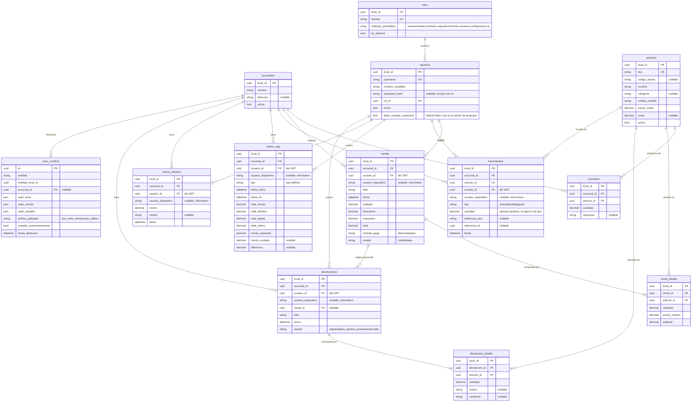

### 3.3 Notas de integridad

- `venta_detalle` **no tiene FK real** a `articulos` (decisión de la Parte 8);
  `inventario`, `movimientos`, `devolucion_detalle` **sí** la tienen.
- `retiros_efectivo` **no tiene FK** a `cortes_caja`: se asocian por rango de
  fecha del lado del dispositivo.
- `sync_conflicts` no participa del ciclo `local_id/remote_id/is_synced/deleted_at`:
  es el propio registro de auditoría; no se borra (no hay `DELETE`).
- Backend: `ventas`, `movimientos`, `cortes_caja` y `retiros_efectivo` tienen
  `local_id UNIQUE` desde la Parte 23 (migración `0012`); `devoluciones` lo
  suma en la Parte 32 (migración `0013`, gap 1 de esa Parte) porque su push
  diferido también lo necesita. En `movimientos` solo las entradas llevan
  `local_id`, igual que los ajustes por delta de `POST /ajustes-inventario`
  (Parte 34, el `local_id` del movimiento `ajuste`); las filas de venta y los
  ajustes por `PATCH /inventario` lo dejan nulo (`UNIQUE` permite múltiples
  `NULL`). Las Partes 34 y 35 no agregaron migraciones Alembic:
  `Inventario.updated_at` pasó a tener `onupdate` en el modelo SQLAlchemy sin
  cambio de esquema, y `PATCH /articulos/{articulo_id}` (Parte 35) reutiliza
  columnas existentes de `articulos` e `inventario`. La Parte 36 tampoco
  agregó migraciones; la Parte 37 agrega la `0014`
  (`usuarios.debe_cambiar_password`, `Boolean` no nulo con `server_default`
  falso, marcada en `true` para el usuario `admin` existente al migrar) y la
  Parte 38 la `0015` (`usuario_dispositivo`, `String(120)` nullable, en
  `ventas`, `movimientos`, `cortes_caja`, `retiros_efectivo` y
  `devoluciones`; las filas existentes quedan en `NULL`). Las columnas
  `usuario_id` de esas tablas guardan desde la Parte 38 el `id` del usuario
  del JWT (texto), no el valor que mande el dispositivo. Room no cambia:
  `usuario_dispositivo` es solo del backend y del contrato.
- `sync_conflicts.politica_aplicada` toma en la práctica valores más
  específicos que los dos del diccionario del esquema: `evento_aditivo_delta`,
  `last_write_wins_local_gana`, `last_write_wins_remoto_gana` (edición de
  catálogo local que perdió, Parte 35) y `reconciliacion_inicial_backend_gana`
  (Parte 34) y `rechazo_backend` (Parte 36). Son valores solo locales del
  dispositivo: no están en el `Literal` del backend porque los conflictos no
  se suben (Backlog).

### 3.4 Room (dispositivo)

- Base `pdv.db`, `@Database(version = 11, exportSchema = true)`, 13 entidades,
  10 DAOs (`PdvDatabase`). Esquemas exportados en `android/app/schemas/`.
- `Converters` (TypeConverters): `BigDecimal <-> String` (`toPlainString`),
  `List<modulo> <-> String` con separador U+001F (Unit Separator).
- `inventario.cantidadNum` (REAL) es columna espejo de `cantidad` (TEXT) para
  poder `SUM()`/`ORDER BY` numérico en SQL (M-9, migración Room `MIGRATION_7_8`).
  Toda escritura de `cantidad` debe pasar por `nuevoInventario(...)` /
  `InventarioEntity.conCantidad(...)` para no desincronizar las dos columnas.
- `inventario.edicionPendiente` (INTEGER/Boolean, default 0) marca que el
  catálogo del artículo o la `ubicacion` de esa fila se editaron localmente y
  falta subirlos (Parte 35, migración Room `MIGRATION_8_9`). Es columna solo
  de cliente, sin contraparte en el backend (`docs/schema-pos.json`, notas de
  `inventario`).
- `syncRechazo` (INTEGER nullable) en `ventas`, `devoluciones`, `cortes_caja`,
  `retiros_efectivo`, `movimientos` e `inventario`: código HTTP con que el
  backend rechazó la fila en el push; `0` = desconocido; nulo = no rechazada
  (Parte 36, migración Room `MIGRATION_9_10`). Columna solo de cliente
  (`sync_rechazo_field` en `docs/schema-pos.json`), sin contraparte en el
  backend ni en Alembic. La migración devuelve a `isSynced = 0` con
  `syncRechazo = 0` y registra en `sync_conflicts` las filas que el push había
  descartado antes (`isSynced = 1` sin `remoteId`), solo en `ventas`,
  `devoluciones`, `cortes_caja`, `retiros_efectivo` y `movimientos` de tipo
  `entrada`/`ajuste`.
- `usuarios.debeCambiarPassword` (INTEGER NOT NULL DEFAULT 0, Parte 37,
  migración Room `MIGRATION_10_11`): marca que el usuario debe cambiar la
  contraseña de arranque. La migración la enciende para el usuario con
  `username = 'admin'` y `deletedAt IS NULL`, sin verificar el hash. Existe
  también en el backend (Alembic `0014`) y en `docs/schema-pos.json`.
- Migraciones registradas en `DatabaseModule`
  (`addMigrations(MIGRATION_7_8, MIGRATION_8_9, MIGRATION_9_10, MIGRATION_10_11)`); la v7 es la línea base con
  `exportSchema` (Parte 24).
- Pruebas instrumentadas (Parte 39, `android/app/src/androidTest/`):
  `MigrationTest` (`MigrationTestHelper` sobre los JSON de `app/schemas/`,
  expuestos como assets de `androidTest` en `build.gradle.kts`; cubre
  `MIGRATION_7_8` y sirve de plantilla para las futuras) y
  `PendingSyncQueriesTest` (queries `isSynced = 0` de ventas sobre SQLite
  real). Ver comandos en [§5.3](#53-android).

---

## 4. Diagramas UML

### 4.1 Componentes (visión conjunta)

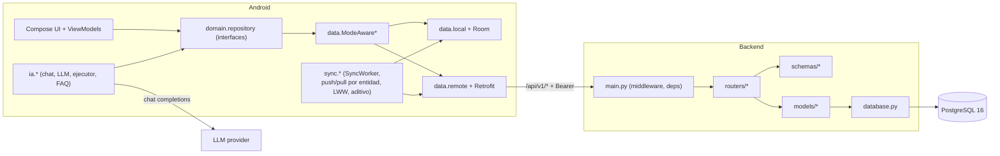

### 4.2 Clases — patrón repositorio `ModeAware` (representativo)

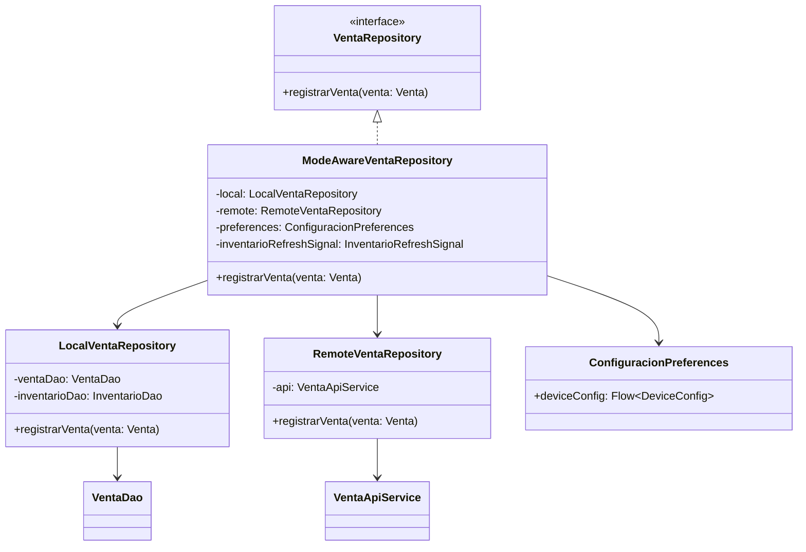

El mismo patrón se repite en las 11 entidades: `Sucursal`, `Venta`, `Entrada`,
`Inventario`, `Caja`, `RetiroEfectivo`, `Devolucion`, `Usuario`, `Rol`,
`SyncConflict`, `Auth` (todas cableadas en `di/RepositoryModule`).

### 4.3 Secuencia — login en modo REMOTO

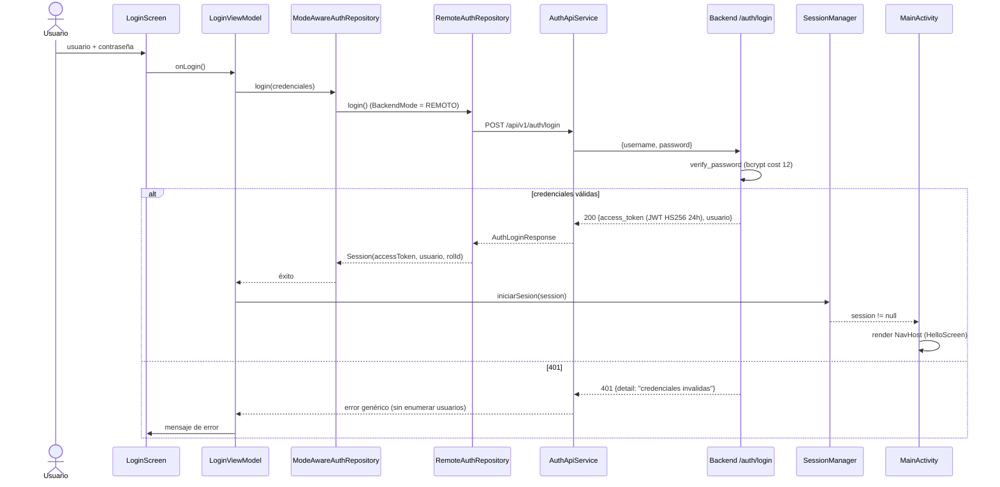

Si el usuario devuelto trae `debe_cambiar_password = true`, la `Session`
lleva `debeCambiarPassword` y `MainActivity` muestra `CambiarPasswordScreen`
(`CambiarPasswordViewModel` -> `AuthRepository.cambiarPassword`, que en REMOTO
llama a `POST /auth/cambiar-password` con el hash bcrypt calculado en el
dispositivo) en vez del `NavHost`; al terminar, la sesión se reinicia con la
marca apagada. En el backend, el login verifica contra `_HASH_FICTICIO` si el
usuario no existe (mismo costo bcrypt) y responde `429` tras 5 fallos por
`username`.

En **modo LOCAL** la rama equivalente va a `LocalAuthRepository`, que valida
contra `usuarios`/`roles` en Room (bcrypt en `Dispatchers.Default`); la sesión
resultante no tiene `accessToken`.

### 4.4 Secuencia — venta en modo REMOTO (con idempotencia y decremento de stock)

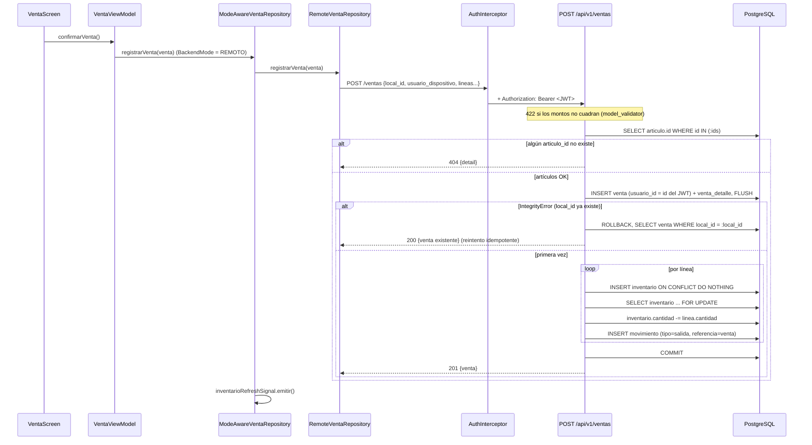

En **modo LOCAL** la operación equivalente ocurre en una transacción Room
(`LocalVentaRepository`): inserta `venta` + `venta_detalle`, decrementa
`inventario`, inserta `movimiento`, todo con `isSynced = false`.

### 4.5 Secuencia — resolución de conflicto de sincronización

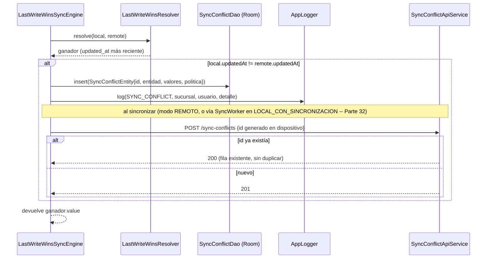

### 4.6 Secuencia — acción del asistente de IA

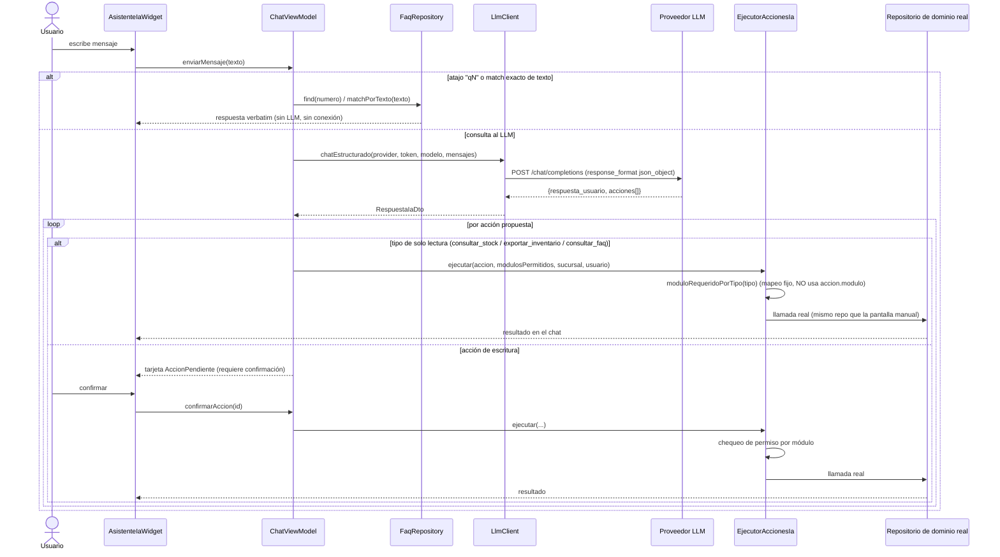

**Seguridad de la IA**: el módulo que autoriza cada acción se deriva **siempre**
de `accion.tipo` (mapa fijo en `EjecutorAccionesIa.moduloRequeridoPorTipo`),
nunca del campo `accion.modulo`, porque ambos vienen de la misma fuente no
confiable (la salida del LLM). Las 4 acciones de escritura exigen confirmación
explícita del usuario en la UI antes de ejecutarse.

### 4.7 Despliegue (Docker Compose)

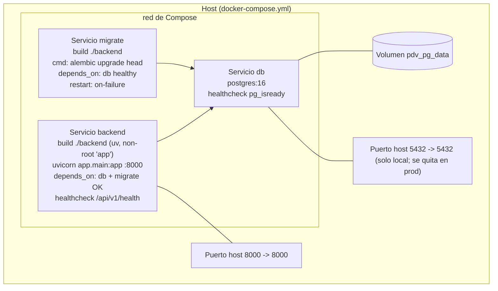

---

## 5. Requerimientos e instalación

### 5.1 Backend — vía Docker (recomendado)

**Requisitos**: Docker + Docker Compose.

```bash
# Windows
scripts/start-windows.ps1     # docker compose up -d --build
scripts/stop-windows.ps1

# Mac
scripts/start-mac.sh
scripts/stop-mac.sh

# Linux
scripts/start-linux.sh
scripts/stop-linux.sh
```

- Backend disponible en `http://localhost:8000`; health en
  `GET /api/v1/health` -> `{"status":"ok","version":"0.1.0"}`.
- El servicio `migrate` aplica todas las migraciones Alembic antes de que
  arranque `backend`.
- **Rebuild obligatorio tras cambiar código de `backend/app/`**: el `Dockerfile`
  hornea el fuente (`COPY app ./app`); no hay volumen ni `--reload`. Volver a
  correr `start-*` (que hace `up -d --build`) es suficiente. `uv run pytest`
  corre contra el host, **no** contra el contenedor: verde en pytest no implica
  contenedor actualizado.

### 5.2 Backend — manual (iteración rápida en debug)

**Requisitos**: Python 3.11+, `uv` (0.10.12+), un PostgreSQL alcanzable.

```bash
cd backend
uv sync                                 # crea .venv desde uv.lock (incluye grupo dev)
uv run uvicorn app.main:app --reload
uv run alembic upgrade head
uv run pytest
uv run alembic check                    # detecta drift modelo <-> migraciones
```

`backend/requirements.txt` es un **export generado** (`uv export`) que se
mantiene solo por compatibilidad externa; no lo consumen ni el `Dockerfile` ni
el CI, y no se edita a mano.

### 5.3 Android

**Requisitos**:
- Android Studio (o SDK de línea de comandos) con **compileSdk 36**, **JDK 17**.
- Dispositivo físico con **Android 8.0+ (API 26)** — objetivo de pruebas:
  **Xiaomi M2102J20SG** — o emulador de fallback.
- Permisos en runtime: `CAMERA` (escaneo de código de barras), `RECORD_AUDIO`
  (entrada por voz del asistente).

```bash
cd android
./gradlew assembleDebug          # genera pos-hello-debug-v0.1.apk
./gradlew installDebug           # instala en el dispositivo/emulador conectado
./gradlew testDebugUnitTest      # tests unitarios JVM
./gradlew lint
./gradlew testReleaseUnitTest    # tests unitarios sobre el variant de release
./gradlew assembleRelease        # APK de release firmado y ofuscado (R8)
```

**Release firmado** (Parte 40, `android/app/build.gradle.kts`): `signingConfigs.release`
toma la firma de `android/keystore.properties` (gitignoreado, igual que `*.jks`
y `*.keystore`; claves `storeFile`, `storePassword`, `keyAlias`, `keyPassword`)
o, si ese archivo no existe, de las variables de entorno `PDV_KEYSTORE_FILE`,
`PDV_KEYSTORE_PASSWORD`, `PDV_KEY_ALIAS` y `PDV_KEY_PASSWORD` (las usa el CI).
Sin ninguno de los dos, `assembleDebug` compila igual y `packageRelease` falla
con el mensaje "Falta la firma de release". El keystore vive fuera del repo
(procedimiento de respaldo y rotación en `CLAUDE.md` §7). El buildType
`release` activa `isMinifyEnabled` e `isShrinkResources`, y el APK se llama
`pos-pdv-release-v<versionName>.apk` (hoy `pos-pdv-release-v1.0.0.apk`).
`proguard-rules.pro` contiene una sola regla propia,
`-keep,allowobfuscation @kotlinx.serialization.Serializable class
com.pdv.pos.data.remote.dto.**`: sin ella R8 eliminaba un DTO referenciado
solo desde la firma genérica de una función `suspend` de Retrofit y el
convertidor fallaba en runtime con "Serializer for class 'Any' is not found".
Room, Hilt, Retrofit, kotlinx-serialization y ML Kit se apoyan en las reglas de
consumidor que traen sus librerías.

**Pruebas instrumentadas** (Parte 39, `app/src/androidTest`): no usar
`connectedAndroidTest`, porque al terminar desinstala la app y borra la base
Room y la clave de Keystore del dispositivo. En su lugar:

```bash
./gradlew installDebug assembleDebugAndroidTest
adb install -r -t app/build/outputs/apk/androidTest/debug/app-debug-androidTest.apk
adb shell am instrument -w com.pdv.pos.test/androidx.test.runner.AndroidJUnitRunner
```

**"Definición de hecho" para cambios en `android/`**: no basta con compilar o
pasar revisión textual; debe quedar instalado y verificado corriendo en el
dispositivo físico (o el emulador de fallback).

#### 5.3.1 Hardware y espacio del dispositivo

El proyecto no declara un piso formal de hardware más allá de `minSdk 26`.
Los valores de abajo son mínimos prácticos derivados del stack (Jetpack
Compose + CameraX + modelo TFLite de ML Kit en el mismo proceso) y de medir
los APK ya compilados.

| Recurso | Mínimo | Recomendado | Notas |
|---|---|---|---|
| SO | Android 8.0 (API 26) | Android 11+ | Validado en Xiaomi M2102J20SG (Redmi Note 10S). |
| CPU / ABI | `armeabi-v7a` (ARM 32-bit) | `arm64-v8a` (ARM 64-bit) | El APK empaqueta las 4 ABIs; en la instalación solo se extrae la nativa de la ABI del dispositivo. |
| RAM | ~2 GB | 3-4 GB | Sin floor declarado. Compose, la vista previa de cámara y el modelo de barcode corren en proceso. |
| Cámara trasera con autofoco | opcional | sí | `uses-feature android:required="false"`: la app instala sin cámara, pero el escaneo de código de barras queda inhabilitado. |
| Micrófono | opcional | — | Solo para la entrada por voz del asistente de IA. |
| Pantalla | teléfono táctil, vertical | — | Diseño Compose pensado para portrait. |
| Red | ninguna en modo LOCAL | Wi-Fi | Wi-Fi en la misma subred para modo REMOTO / sync. Internet solo para el asistente de IA. |

**Tamaño de los artefactos** (sin App Bundle ni ABI splits):

- APK debug: **41,6 MB** (medición anterior a la Parte 40, sin R8) <!-- VERIFICAR: no se re-midió el APK debug tras la Parte 40 -->.
- APK release con R8 y `isShrinkResources` (Parte 40): **25 103 991 bytes**
  (~25,1 MB), firmado; `docs/PLAN.md` registra 36 560 235 bytes sin R8 el
  2026-10-25 (-31 %).
- DEX del debug (multidex, 17 archivos): ~45 MB sin comprimir — grande porque
  el debug no minifica.
- Nativas de ML Kit barcode (`libbarhopper_v3.so`): ~4,8 MB para la ABI
  `arm64-v8a` + ~0,9 MB de modelos `.tflite` empaquetados (sin descarga en
  runtime).

**Espacio en el dispositivo:**

| Concepto | Estimación | Comentario |
|---|---|---|
| Instalación de la app | ~90-160 MB | APK almacenado + librería nativa de la ABI extraída + artefactos AOT de ART (oat/vdex). **Reservar >= 250 MB libres.** |
| `pdv.db` (Room) | Catálogo de miles de artículos ~ pocos MB; ~1-2 KB por venta (venta + líneas + movimientos + ajuste de inventario) -> 10 000 ventas ~ 15-25 MB | **Sin purga automática** (todo es soft-delete). Un dispositivo con años de operación offline necesita una estrategia de archivado/depuración. |
| Logs (`AppLogger`) | Pocos MB típico; decenas de MB con logging intenso | Archivos `app-log-*.txt` de 5 MB máx.; se purgan los de más de 30 días. No hay tope de tamaño total, solo retención temporal. |
| Tickets PDF y exportaciones CSV/Excel | Pequeño (ticket pocos KB; export escala con el catálogo) | Van a `cacheDir/exports/`. Son cache: el SO puede evictarlos bajo presión de almacenamiento; la app no los borra por su cuenta. |

El shrink de la Parte 40 ya redujo el tamaño de descarga; el AAB / ABI splits
no se aplican (el canal es sideload de APK).

### 5.4 Conectividad dispositivo físico -> backend

**Camino principal — Wi-Fi en la misma subred:**
1. Teléfono y PC en la misma red Wi-Fi.
2. En la app: panel de conexión (login o Configuración) -> modo **REMOTO**,
   esquema `http`, IP = IP LAN de la PC (`ipconfig` -> "Dirección IPv4"),
   puerto `8000`.
3. Regla de firewall de Windows (una sola vez, PowerShell admin):
   ```powershell
   New-NetFirewallRule -DisplayName "PDV backend 8000" -Direction Inbound -Protocol TCP -LocalPort 8000 -Action Allow
   ```
4. Si el router aísla clientes Wi-Fi ("AP/client isolation"), desactivarlo.
5. La IP LAN es DHCP y puede cambiar entre reinicios: reservarla (DHCP estático)
   o fijar IP estática en la PC.

**Alternativa — túnel USB (`adb reverse`):** IP `localhost:8000` en la app y en
la PC:
```powershell
scripts\install-apk-tuneling.ps1   # installDebug + adb reverse tcp:8000 tcp:8000
scripts\stop-apk-services.ps1
```
El túnel **no persiste** entre reconexiones de cable, reinicios ni
`adb kill-server`; hay que rehacerlo cada sesión.

**Cleartext HTTP**: habilitado solo en el build de **debug**
(`app/src/debug/res/xml/network_security_config.xml`, `base-config`). El build
de release no incluye ese archivo y el manifest principal declara
`android:usesCleartextTraffic="false"` (Parte 40): en release "Probar conexión"
contra `http://<IP LAN>:8000` falla con "CLEARTEXT communication ... not
permitted" (verificado en el Xiaomi el 2026-10-26). Consecuencia: con el APK de
release los modos REMOTO y LOCAL_CON_SINCRONIZACION solo funcionan contra un
backend HTTPS; el modo LOCAL no se ve afectado.

### 5.5 Asistente de IA (opcional)

- En Configuración: activar IA, elegir proveedor (`DEEP_SEEK` / `OPEN_AI` /
  `OPEN_ROUTER`), pegar el **API key del proveedor** y opcionalmente el modelo.
- El token se cifra con AES-256 respaldado por Android Keystore; en DataStore
  solo se guarda ciphertext + IV (`AndroidKeystoreTokenCipher`).
- Encender la IA exige antes aceptar un diálogo de consentimiento (datos que se
  envían al proveedor); `ChatViewModel` no llama al proveedor salvo que
  `IaConfig.puedeEnviar` (activo y consentimiento) sea verdadero. Apagar la IA
  retira el consentimiento (Parte 40, A-7).
- El asistente llama directo al proveedor por HTTPS; no pasa por el backend.

### 5.6 Secretos y despliegue no-local

- `docker-compose.yml` usa defaults solo-local (`pdv`/`pdv`, `JWT_SECRET_KEY`
  de desarrollo) vía `${VAR:-default}` y fija `PDV_ENV: development`, que es lo
  que habilita esa clave de desarrollo y `/docs` (Parte 37).
- Para cualquier entorno no-local: copiar `docker-compose.prod.yml.example` a
  `docker-compose.prod.yml` (gitignoreado) con `JWT_SECRET_KEY` fuerte,
  `PDV_ENV: production` y credenciales reales de Postgres, y levantar con
  `docker compose -f docker-compose.yml -f docker-compose.prod.yml up -d --build`.
- El destino de despliegue productivo (Render / Fly.io / VPS / AWS) está
  **sin decidir** (`CLAUDE.md` §7 `[TODO]`): la Parte 40 lo difirió al Backlog
  (2026-10-25) porque el primer release se centra en el modo local; la
  recomendación registrada es un VPS propio con el compose tal cual, Caddy como
  proxy TLS y `pg_dump` programado.

---

## 6. Configuración

### 6.1 Backend — variables de entorno

| Variable | Default | Uso |
|---|---|---|
| `DATABASE_URL` | `postgresql+asyncpg://pdv:pdv@db:5432/pdv` | Conexión async a Postgres (`app/database.py`, `alembic/env.py`). |
| `JWT_SECRET_KEY` | Sin default en código (el `docker-compose.yml` local inyecta `dev-secret-key-cambiar-en-produccion`) | Firma HS256 de los JWT (`app/security.py`, validada en `app/config.py`). **Obligatoria**: el proceso no arranca sin ella (`RuntimeError`), ni con el valor de desarrollo si `PDV_ENV` no es `development`. |
| `PDV_ENV` | `production` si falta (el `docker-compose.yml` local fija `development`) | `development` habilita la clave JWT de desarrollo y `/docs`, `/redoc`, `/openapi.json`; cualquier otro valor los deshabilita (`app/config.py`). |

Parámetros fijos en código (`app/security.py`): `JWT_ALGORITHM = "HS256"`,
`JWT_EXPIRES_MINUTES = 60*24` (24 h), bcrypt `rounds=12`; en
`app/limite_login.py`: `MAX_FALLOS = 5`, `VENTANA_SEGUNDOS = 15*60`.

### 6.2 Android — DataStore (`configuracion`)

`ConfiguracionPreferences` sobre DataStore Preferences (sin Room). Claves:

| Clave | Tipo | Descripción |
|---|---|---|
| `backend_mode` | `LOCAL` / `REMOTO` / `LOCAL_CON_SINCRONIZACION` | Modo activo. Default `LOCAL`. |
| `esquema` | `HTTP` / `HTTPS` | Esquema de la conexión remota (`EsquemaConexion`). Default `HTTP`. |
| `ip` | String | Host del backend remoto. |
| `puerto` | String | Puerto del backend remoto. |
| `sucursal_id_seleccionada` | String? | Sucursal activa del dispositivo. |

`ConfiguracionViewModel` empareja la sucursal guardada por `id` o `remoteId`
(`Sucursal.remoteId`, Parte 36) y solo persiste la primera del catálogo cuando
no hay ninguna guardada; desde la Parte 40 lo hace también en modo LOCAL, y
`SucursalInicial` (invocada desde `PdvApplication`) la preselecciona al arrancar
en LOCAL.

Otras preferencias: `IaPreferences` (activo, proveedor, modelo, token cifrado y,
desde la Parte 40, `ia_consentimiento`),
`PromptIaPreferences` (prompt de sistema editable), `SyncStateStore` (Parte
32: `lastSuccessAtMillis`, `lastError`, cursor `updated_since` del pull por
`(entidad, sucursal)` desde la Parte 34, y banderas
`sync_inventario_reconciliado_v2_<sucursal>` y, desde la Parte 35,
`sync_catalogo_reconciliado_<sucursal>`), `SessionStore` (Parte 32: sesión del usuario para el `SyncWorker`
desatendido, `accessToken` cifrado igual que el token de IA; desde la Parte 37
guarda también `session_debe_cambiar_password`; desde la Parte 40,
`session_ultimo_uso` con la hora en que la app pasó a segundo plano). `LimpiezaDataStore` (Parte
37) borra al arrancar las claves obsoletas `ia_token` (API key en claro de un
build previo al cifrado), `nombre_base_datos` y los cursores de pull sin
sucursal.

`DynamicHostInterceptor` cachea `DeviceConfig` en un campo `@Volatile` (sembrado
una vez de forma bloqueante, mantenido por un colector) y reescribe
esquema/host/puerto de cada request; si no hay IP o el puerto no es numérico,
deja pasar la request con el `BASE_URL` por defecto
(`http://localhost:8000/api/v1/`).

### 6.3 Versionado de la app

- `versionName` SemVer `MAJOR.MINOR.PATCH` (cadena legible del alcance
  publicado; se sube a mano en el commit de release).
- `versionCode = MAJOR*10000 + MINOR*100 + PATCH` (entero monotónico, sin
  colisiones entre APKs distribuidos).
- Hoy: `versionCode = 10000` / `versionName = "1.0.0"` (primer release, Parte 40;
  `aapt2 dump badging` lo confirmó el 2026-10-25). El debug conserva el nombre
  de archivo `pos-hello-debug-v0.1.apk`; el release emite
  `pos-pdv-release-v<versionName>.apk`.

---

## 7. Seguridad

| Aspecto | Implementación |
|---|---|
| **Contraseñas** | bcrypt cost 12 en ambos lados. El hash se calcula **siempre en el dispositivo Android** que recibe el texto plano; el endpoint de usuarios recibe `password_hash` ya calculado y nunca devuelve el hash. Desde la Parte 37 el `password_hash` de entrada se valida con el prefijo bcrypt (`BCRYPT_PATTERN`, `422` si no lo cumple; antes un hash inválido hacía fallar el login con `500`). |
| **Contraseña de arranque** | El admin sembrado por la migración `0009` (`admin/admin123`) queda con `debe_cambiar_password = true` (Alembic `0014`, Room `MIGRATION_10_11`). Mientras la marca siga encendida, el backend responde `403 "debe cambiar la contrasena"` en toda ruta protegida y solo `POST /auth/cambiar-password` acepta su token; la app fuerza `CambiarPasswordScreen` (rechaza la contraseña inicial como nueva) y `DefaultSyncOrchestrator` no sube nada (`MOTIVO_CAMBIAR_PASSWORD`). |
| **Límite de intentos y tiempo constante** | `limite_login`: 5 fallos en 15 min por `username` -> `429` (incluso con la contraseña correcta mientras dure el bloqueo); contador en memoria por worker. El login verifica contra `_HASH_FICTICIO` cuando no hay hash real para igualar el tiempo de respuesta. |
| **Secreto JWT y entorno** | `JWT_SECRET_KEY` obligatoria sin default en código; el valor de desarrollo solo se acepta con `PDV_ENV=development`; `/docs`, `/redoc` y `/openapi.json` solo existen en `development` (`app/config.py`). |
| **Integridad de roles y administradores** | `DELETE /roles/{id}` con usuarios asignados -> `409`; un rol borrado no otorga módulos (`modulos_del_usuario` en `app/permissions.py`); desactivar o borrar al propio usuario o al último usuario activo con el módulo `usuarios` -> `409`. |
| **Respaldo del dispositivo** | `allowBackup="false"` más `res/xml/data_extraction_rules.xml` (excluye nube y transferencia entre dispositivos): las claves de Android Keystore no viajan, así que sesión y token de IA cifrados quedarían ilegibles. |
| **Atribución de escrituras** | Desde la Parte 38 el `usuario_id` de ventas, movimientos, cortes, retiros y devoluciones es el `id` del usuario del JWT (`Depends(usuario_actual)`); el request ya no lo trae, así que un cliente no puede registrar operaciones a nombre de otro. El usuario local del dispositivo viaja como `usuario_dispositivo` (informativo, máx. 120 caracteres). Venta y corte con montos incoherentes se rechazan con `422`. |
| **Tokens** | JWT `HS256`, `sub` = `usuario.id`, expiración 24 h, firmado con `JWT_SECRET_KEY`. Sin `refresh_token` (diferido, ratificado en la Parte 32: se mantiene el JWT de 24 h + re-login al recibir 401, aunque `SessionStore` persista la sesión para el worker de sync). |
| **Enforcement backend** | `Depends(usuario_actual)` en el router `protected`: valida firma/expiración y que el `sub` corresponda a un usuario existente, activo y no borrado. `401 {"detail": "token invalido o expirado"}` genérico. `health` y `auth` exentos. |
| **Autorización por módulo** | `verificar_modulo` gatea **solo escrituras** (`POST`/`PATCH`/`DELETE`) según `(método, ruta)` -> módulo requerido (mapa en `app/permissions.py`). Los `GET` solo exigen token válido. `403 {"detail": "el rol no tiene permiso para el modulo: X"}`. |
| **Expiración de la sesión por inactividad** | Parte 40 (M-5): la ventana de inactividad abre cuando `MainActivity.onStop` llama a `SessionManager.registrarUso` (guarda `session_ultimo_uso` en `SessionStore`) y se evalúa en `onStart` con `cerrarSiExpirada`; `restaurarSesion` descarta la sesión persistida si venció. Límite `INACTIVIDAD_MAXIMA_MILLIS` = 12 horas en segundo plano (el tiempo en primer plano no cuenta; una sesión recién iniciada sin marca no expira). Una sesión expirada detiene el sync de `LOCAL_CON_SINCRONIZACION` (`MOTIVO_SIN_SESION`). |
| **Cleartext y build de release** | Debug permite HTTP a cualquier host (`base-config`); release declara `usesCleartextTraffic="false"` y no incluye el network security config de debug. El release además va firmado y ofuscado con R8 (ver [§5.3](#53-android)). |
| **Reacción del cliente a 401** | `AuthInterceptor` cierra la sesión y vuelve a `LoginScreen` **solo si** la request llevaba token (`token != null`), no era `/auth/login` y el modo es `REMOTO` (Parte 36, M-5). Un 401 a una request sin token (esperado en LOCAL / LOCAL_CON_SINCRONIZACION contra un backend con enforcement) lo maneja el repositorio que llamó; un 401 con token en `LOCAL_CON_SINCRONIZACION` lo registra el orquestador de sync ("sync requiere re-login") sin cerrar la sesión. |
| **No enumeración de usuarios** | `/auth/login` devuelve el mismo 401 para usuario inexistente, inactivo, sin hash o contraseña incorrecta. |
| **Token de IA** | Cifrado AES-256 con clave respaldada por Android Keystore; solo ciphertext + IV en DataStore. El token viaja únicamente en el header del request al proveedor, nunca se loguea. Si el descifrado lanza `GeneralSecurityException` (clave de Keystore ausente tras reinstalar o restaurar), `IaPreferences` lo trata como "sin token" y borra las claves; `SessionStore` hace lo mismo con la sesión (Parte 37). |
| **Consentimiento de IA** | Parte 40 (A-7): el diálogo de Configuración declara los datos que van al proveedor (mensaje e historial, nombre de sucursal y resumen de inventario con SKU, nombre, existencias, precio, costo y ubicación, totales de caja del día, y el texto del dictado por voz). `IaPreferences.consentimiento` (`ia_consentimiento`) más `IaConfig.puedeEnviar`: `ChatViewModel` no envía nada si no hay activo y consentimiento; apagar la IA retira el consentimiento. |
| **Autorización de acciones de IA** | El módulo a autorizar se deriva del `tipo` de acción (mapa fijo), nunca del campo `modulo` de la salida del LLM. Confirmación explícita del usuario para las 4 acciones de escritura. |
| **CORS** | `CORSMiddleware` con `allow_origins=["*"]` (no hay cliente web; revisar el día que exista uno). Los `500` del handler global **no llevan headers CORS** (posición de `ServerErrorMiddleware` en el stack de Starlette). |
| **Contenedor** | Corre como usuario no privilegiado `app` (`adduser --system` + `USER app` en el `Dockerfile`). |
| **Logging de auditoría** | `AppLogger` (dispositivo): categoría `AUTH` para logins y rechazos de permiso de la IA; `SYNC_CONFLICT` para conflictos. Archivos `.txt` locales, nunca viajan por API. Backend: logging operativo a stdout/stderr, nivel `ERROR` en el handler global. |

**Estado de seguridad del primer release (Parte 40):** APK de release firmado
(keystore fuera del repo, `CLAUDE.md` §7), R8 con shrink de recursos y
cleartext deshabilitado, verificados en el Xiaomi el 2026-10-26. La Parte 37
(`docs/PLAN.md`, hallazgos A-3, A-4, A-5, M-4, M-6 y M-10 de
`docs/review_code.md`) quedó implementada, verificada en dispositivo y
mergeada (PR #47): cambio forzado de la contraseña `admin/admin123`,
`JWT_SECRET_KEY` obligatoria, límite de intentos de login, `/docs`
deshabilitado fuera de desarrollo y `allowBackup`/limpieza de claves. Quedan
diferidos al Backlog el backend productivo por HTTPS con `JWT_SECRET_KEY` fuerte
y el respaldo de Postgres. Queda como tarea operativa, a cargo del usuario,
rotar la API key del proveedor de IA del dispositivo de pruebas.

---

## 8. Referencia de API

Base URL dev: `http://localhost:8000/api/v1`. Detalle completo (bodies,
códigos de error, ejemplos): `docs/api-contract.md`. Con la contraseña de
arranque pendiente de cambio, toda ruta protegida responde `403 {"detail":
"debe cambiar la contrasena"}`.

| Método | Ruta | Módulo (escritura) | Notas |
|---|---|---|---|
| GET | `/health` | — (exenta) | Liveness. |
| POST | `/auth/login` | — (exenta) | Devuelve JWT + usuario (con `debe_cambiar_password`). `429` tras 5 fallos por `username` en 15 min (Parte 37). |
| POST | `/auth/cambiar-password` | — (exenta; exige Bearer) | Cambia la contraseña del usuario del token (body `password_hash` bcrypt) y apaga `debe_cambiar_password`; `204`. Única ruta que acepta el token de un usuario con la marca encendida (Parte 37). |
| GET / POST | `/sucursales` | `configuracion` (POST) | Paginado. |
| GET / POST | `/sync-conflicts` | — (infraestructura) | POST idempotente por `id` del dispositivo. |
| POST | `/ventas` | `venta` | Idempotente por `local_id`. Decrementa inventario + movimiento. `usuario_id` sale del JWT (el body trae `usuario_dispositivo`); `422` si los montos no cuadran (Parte 38). |
| POST | `/entradas` | `entrada` | Idempotente por `local_id`. Alta de artículo + inventario + movimiento en una llamada atómica. `usuario_id` del JWT (Parte 38). |
| GET | `/inventario` | — | `sucursal_id` requerido; `q` filtra nombre/SKU/código; `updated_since` para el pull del sync diferido (Parte 32) filtra por `inventario.updated_at` o `articulos.updated_at` (Parte 35); el `updated_at` devuelto es el mayor de ambos, cambia con todo movimiento de stock (Parte 34) o edición de catálogo, y el cliente consulta con 2 min de solape. |
| PATCH | `/inventario/{articulo_id}` | `inventario` | `cantidad` = nuevo valor; el server aplica el delta con signo. Valor absoluto: queda para el modo REMOTO interactivo (el sync diferido usa `/ajustes-inventario`). El movimiento lleva `usuario_id` del JWT y `usuario_dispositivo` del body (Parte 38). |
| POST | `/ajustes-inventario` | `inventario` | Ajuste de existencia por **delta** con signo (`delta` distinto de 0), idempotente por `local_id` del movimiento (`201` aplicado, `200` reintento), con `FOR UPDATE` (`bloquear_inventario`, Parte 38); lo usa el sync diferido (Parte 34, `docs/api-contract.md` 7.4). `usuario_id` del JWT. No toca catálogo ni `ubicacion`. |
| PATCH | `/articulos/{articulo_id}` | `inventario` | Edita nombre, descripción, categoría, unidad de medida, precio, costo y `ubicacion` (de la sucursal del body) sin tocar `cantidad` ni crear movimiento. Last-write-wins: se aplica si `editado_en` >= `articulos.updated_at`; responde `200` con `aplicado` true/false y el estado vigente. Bloquea el artículo con `FOR NO KEY UPDATE`; `404` si no existe el artículo o la sucursal (Parte 35, `docs/api-contract.md` 7.5). Desde la Parte 38 no recibe usuario. |
| GET | `/inventario/ubicaciones` | — | Valores usados. |
| GET | `/articulos/categorias`, `/articulos/unidades-medida` | — | Valores usados (sin tabla de catálogo). |
| POST / GET | `/cortes-caja` | `caja` (POST) | Idempotente por `local_id`. `usuario_id` del JWT; `422` si las fechas o los totales son incoherentes (Parte 38). Filtros `desde`/`hasta`/`updated_since` (este último para el pull del sync diferido). |
| GET | `/cortes-caja/totales` | — | Agrega ventas/retiros del periodo. |
| POST / GET | `/retiros-efectivo` | `caja` (POST) | Idempotente por `local_id`. `usuario_id` del JWT (Parte 38). Filtros `desde`/`hasta`/`updated_since` (pull del sync diferido). |
| POST | `/devoluciones` | `devoluciones` | Con líneas. No toca inventario. Idempotente por `local_id` (Parte 32). `usuario_id` del JWT; `estado` solo `registrada`, `en_gestion_proveedor` o `cerrada` (`422` otro valor) (Parte 38). |
| GET / POST / PATCH / DELETE | `/roles` | `usuarios` (escrituras) | Roles de sistema: `400` a PATCH/DELETE. DELETE = soft-delete; `409` si el rol tiene usuarios asignados (Parte 37). |
| GET / POST / PATCH / DELETE | `/usuarios` | `usuarios` (escrituras) | Nunca devuelve `password_hash`; el `password_hash` de entrada se valida como bcrypt (`422`). DELETE = soft-delete. `409` al desactivar (PATCH con `activo=false`) o borrar al propio usuario o al último con el módulo `usuarios` (Parte 37). |

**Convenciones**: fechas ISO-8601 UTC; IDs UUID v4 (string); paginación
`page` (1-indexed) + `page_size` (default 20, max 100); errores de negocio
`{ "detail": "..." }`; errores de validación con el shape estándar de
FastAPI/Pydantic (`422`).

**Al cambiar un endpoint**: actualizar primero `docs/api-contract.md`, luego el
backend (schema + router + modelo + migración si aplica), luego el cliente
Kotlin (DTO + ApiService + Remote*Repository). Existe una skill `sync-api-contract`
para guiar el proceso.

---

## 9. Operación y diagnóstico

### 9.1 Health y estado

| Qué | Cómo |
|---|---|
| Backend vivo | `curl http://<host>:8000/api/v1/health` -> `{"status":"ok","version":"0.1.0"}`. |
| Contenedores | `docker compose ps` (backend `healthy`, `migrate` `exited 0`). |
| Migraciones aplicadas | `docker compose exec backend alembic current` (debe coincidir con el head del repo, hoy `0015`). |
| Prueba de conexión desde la app | Panel de conexión -> "Probar conexión" (`BackendHealthChecker`, OkHttp propio sin interceptores, contra la URL tecleada). |

### 9.2 Logs del backend

- Módulo `logging` estándar, **nunca `print()`**. Salida a stdout/stderr; el
  contenedor la captura (`docker compose logs -f backend`). Sin archivos ni
  rotación propios.
- Nivel `INFO` por defecto; `ERROR` para excepciones no capturadas por el
  handler global (`app/main.py`), con `exc_info` (traceback completo del lado
  servidor, nunca al cliente).

### 9.3 Logs / auditoría del dispositivo

- `AppLogger` escribe en `filesDir` archivos `app-log-<yyyyMMdd-HHmmss>.txt`,
  una línea por evento: `[TIPO][yyyy-MM-dd HH:mm:ss][sucursalId][usuario] mensaje`.
- Rotación al superar 5 MB (archivo nuevo); la purga de archivos con más de 30 días corre solo al rotar (Parte 39). Las marcas de tiempo usan `DateTimeFormatter`; el arranque ya no escribe la línea de prueba "Verificacion Parte 5".
- Categorías: `ERROR`, `WARN`, `INFO`, `DB_WRITE`, `SYNC_CONFLICT`, `AUTH`.
- Extracción:
  ```bash
  adb shell run-as com.pdv.pos ls files/
  adb exec-out run-as com.pdv.pos cat files/app-log-XXXXXXXX-XXXXXX.txt > log.txt
  ```
- Logcat de red (solo debug): `HttpLoggingInterceptor` nivel `BASIC`
  (método/URL/estado, sin cuerpos ni headers), gateado por `BuildConfig.DEBUG`
  (M-8). El cliente de IA nunca tiene interceptor de logging.

### 9.4 Inspeccionar Room en el dispositivo

Técnica validada (memoria de la Parte 7): copiar `pdv.db` con `run-as` y
abrirla con el `sqlite3` de la stdlib de Python (evita depender del binario
`sqlite3` en el device):

```bash
adb exec-out run-as com.pdv.pos cat databases/pdv.db > pdv.db
python -c "import sqlite3;c=sqlite3.connect('pdv.db');print(c.execute('select name from sqlite_master where type=\"table\"').fetchall())"
```

### 9.5 Problemas frecuentes y causa raíz

| Síntoma | Causa raíz | Acción |
|---|---|---|
| El contenedor no refleja un cambio de `backend/app/` | El `Dockerfile` hornea el fuente; no hay volumen ni `--reload`. `uv run pytest` corre contra el host. | `scripts/start-*` (hace `up -d --build`). Verificar con `docker compose exec backend`. |
| `migrate` en *restart-loop* / esquema inconsistente | Esquema creado fuera de Alembic (`create_all` sin fila en `alembic_version`). | Bajar el stack, `docker volume rm <proj>_pdv_pg_data`, re-levantar para que `migrate` cree el esquema desde cero; nunca crear tablas fuera de Alembic. |
| App en modo REMOTO no alcanza el backend por Wi-Fi | Firewall de Windows bloquea inbound TCP 8000 / IP LAN cambió por DHCP / router con client isolation. | Regla `New-NetFirewallRule` (§5.4); reservar IP o fijarla estática; desactivar AP isolation. |
| Modo REMOTO funcionó y dejó de funcionar tras reconectar el USB | `adb reverse` no persiste entre reconexiones/reinicios/`adb kill-server`. | Rehacer `adb reverse tcp:8000 tcp:8000` o pasar a Wi-Fi. |
| En `LOCAL_CON_SINCRONIZACION`: crash o logout al vender / entrar a Configuración | Latente desde la Parte 21: `GET /sucursales` responde 401 sin JWT (login local no tiene token); la `HttpException` subía sin manejar y `AuthInterceptor` cerraba sesión ante cualquier 401. | **Corregido en la Parte 31**: `ModeAwareSucursalRepository` degrada al catálogo local (`.catch`); `AuthInterceptor` solo cierra sesión si la request llevaba token. Si reaparece, revisar que esas dos guardas sigan en su lugar. |
| Configuración muestra "Rechazadas por el backend: N (ver Conflictos)" | El backend respondió 4xx (no 401) al subir esas filas (ej. 403: el rol del backend no tiene el módulo). Quedan con `syncRechazo` y no se reintentan (Parte 36). | Abrir Conflictos para ver la entidad y el código HTTP; corregir la causa (ej. dar el módulo al rol). Aún no hay acción de reintento (Backlog). |
| Configuración muestra "Último error: sync requiere re-login" | El backend respondió 401 al `SyncWorker`: JWT vencido, o la sesión no tiene token (login con el backend inalcanzable). | Cerrar sesión y entrar de nuevo con el backend alcanzable. |
| Asistente de IA: "El proveedor no devolvió ninguna respuesta" intermitente | DeepSeek `deepseek-chat` con `response_format=json_object` devuelve `content` vacío de forma intermitente (`finish_reason` / `usage` en el log de `LlmClient` lo distinguen). | Conocido (Backlog). Reintentar el mensaje; evaluar `max_tokens` explícito / reintento único. |
| Asistente de IA: "La IA devolvió una respuesta con formato inválido" | El proveedor no respetó el JSON de `RespuestaIaDto`. `FORMATO_SALIDA_ACCIONES` + `instruccionFaq` se concatenan al prompt para mitigarlo. | Revisar el log `LlmClient` (contenido truncado + `finish_reason`). Verificar el prompt de sistema editable. |
| Test de backend verde pero el device falla contra el backend dockerizado | pytest corre contra el host; la imagen puede estar desactualizada. | Rebuild de la imagen antes de verificar en device. |
| Todas las rutas responden `403 "debe cambiar la contrasena"` | El usuario del token conserva `debe_cambiar_password = true` (admin de arranque tras la migración `0014`). | Cambiar la contraseña desde `CambiarPasswordScreen` o con `POST /auth/cambiar-password`. |
| `POST /auth/login` responde `429` aun con la contraseña correcta | Bloqueo del `username` por 5 fallos en 15 min (`limite_login`, memoria del worker). | Esperar a que venza la ventana o reiniciar el backend; el contador no se persiste. |
| El contenedor del backend termina con `RuntimeError: JWT_SECRET_KEY ...` | Falta `JWT_SECRET_KEY`, o tiene el valor de desarrollo con `PDV_ENV` distinto de `development`. | Definir una clave propia en el entorno del despliegue (`docker-compose.prod.yml`). En local, `PDV_ENV=development` (lo fija el `docker-compose.yml`). |
| `/docs` devuelve `404` | Sin `PDV_ENV=development` el backend no expone `/docs`, `/redoc` ni `/openapi.json`. | Esperado fuera de desarrollo. |
| Configuración muestra "Último error: cambia la contrasena inicial antes de sincronizar" | La sesión tiene `debeCambiarPassword`; el orquestador no sube hasta el cambio. | Cambiar la contraseña inicial. |
| Con el APK de release: "Probar conexión" a `http://<IP>:8000` falla con "CLEARTEXT communication ... not permitted" | Esperado: el release declara `usesCleartextTraffic="false"` (Parte 40). | Usar un backend HTTPS, o el build de debug para pruebas en la LAN. |
| Con el APK de release: "Unable to create converter for class java.lang.Object" o "Serializer for class Any is not found" | R8 eliminó un DTO `@Serializable` que solo aparecía en la firma genérica de una función `suspend` de Retrofit (caso `HealthResponseDto`). | Mantener la regla `-keep,allowobfuscation` sobre `com.pdv.pos.data.remote.dto.**` en `proguard-rules.pro`; desofuscar el stack trace con `app/build/outputs/mapping/release/mapping.txt`. |
| `assembleRelease` falla en `packageRelease` con "Falta la firma de release" | No existe `android/keystore.properties` ni las variables `PDV_KEYSTORE_*`. | Crear el archivo o definir las variables (`CLAUDE.md` §7). |
| Al abrir la app aparece el login aunque había sesión | Pasaron más de 12 horas en segundo plano (`SessionManager.cerrarSiExpirada`, Parte 40). | Esperado; volver a iniciar sesión. El sync de `LOCAL_CON_SINCRONIZACION` reporta "no hay sesion activa" hasta entonces. |
| El asistente de IA responde "La IA no está activada" con la IA activa de antes | Falta el consentimiento (`ia_consentimiento`): un dispositivo con la IA activa de antes de la Parte 40 vuelve a pedirlo. | Volver a encender la IA en Configuración y aceptar el diálogo. |
| Carrera KSP debug/release al compilar Android | Hallazgo transitorio de la Parte 24 (a vigilar en la Parte 26 / CI). | `./gradlew clean` y recompilar; reportar si es reproducible. |
| OpenRouter nunca probado en vivo | No hay token de OpenRouter en el entorno. | Cargar un token real para validar antes de recomendar ese proveedor a un comercio. |

---

## 10. Mantenimiento

### 10.1 Estructura del repositorio

```
PDV/
├── android/        App Android nativa (Kotlin)         -> build system Gradle
├── backend/        API FastAPI (Python)                -> build system uv + Docker
├── scripts/        Arranque/detención del backend, tuneling APK;
│                   scripts/docs/ (build_manual.py + manual-template.html)
├── docs/           PLAN.md, PLAN-historico.md, api-contract.md,
│                   schema-pos.json, review_code.md (+ la revisión anterior
│                   review_code_2026-09-28_1816.md), inventario-inicial.csv,
│                   ALCANCE-DOCS.md (alcance del manual), manual-tecnico.md
│                   (este archivo); los derivados .html/.pdf están en
│                   .gitignore y se generan bajo demanda; mipe-logo/ (SVG
│                   del logo MiPE; los PNG no se versionan)
├── .claude/commands/  Comandos slash del proyecto (/parte, /docs-sync, /jira-sync)
├── .claude/agents/    Subagentes (doc-maintainer)
├── .claude/hooks/     docs_guard.py (PreToolUse, registrado en .claude/settings.json)
├── .github/workflows/ android-ci.yml, backend-ci.yml
├── docker-compose.yml + docker-compose.prod.yml.example
└── CLAUDE.md       Contexto de proyecto (raíz del monorepo)
```

Los dos módulos son independientes en build system pero deben mantenerse
sincronizados vía `docs/api-contract.md`.

### 10.2 CI

- **`.github/workflows/backend-ci.yml`** (trigger en `backend/**`): servicio
  Postgres 16, `astral-sh/setup-uv@v6` (pin `0.10.12`), `uv lock --check`
  (falla si `uv.lock` está desactualizado), `uv sync --frozen`,
  `uv run alembic upgrade head`, `uv run alembic check`, `uv run pytest`.
- **`.github/workflows/android-ci.yml`** (trigger en `android/**`): tests y lint,
  verificación de que `app/schemas` está al día y, desde la Parte 40 (B-9), el
  paso "Compilar la variante de release": genera con `keytool` un keystore
  desechable (PKCS12, validez 1 día) en `runner.temp`, lo pasa por las variables
  `PDV_KEYSTORE_*` y corre `./gradlew assembleRelease --max-workers=1`, para que
  un fallo de reglas keep de R8 aparezca en CI. El APK resultante no sirve para
  distribuir.
- **No hay CI/CD de despliegue** todavía (pendiente; Parte 26 del historial /
  Parte 40).

### 10.3 Pruebas

| Lado | Comando | Estado de referencia |
|---|---|---|
| Backend | `uv run pytest` | 17 archivos `test_*.py` más `conftest.py` (la Parte 37 sumó `test_config.py` y `test_limite_login.py`; la Parte 38 amplió `test_ventas.py`, `test_entradas.py`, `test_inventario.py`, `test_caja.py` y `test_devoluciones.py`, incluido un test de 6 ventas concurrentes sin fila previa de inventario), **226 passed** (registrado en `docs/PLAN.md` el 2026-10-21, tras la Parte 38). Cobertura: happy path + ≥1 error por endpoint, más `test_schema_parity.py`, `test_auth_enforcement.py`, `test_permisos.py`. |
| Android | `./gradlew testDebugUnitTest` | 97 archivos `*Test.kt` (la Parte 40 sumó `SucursalInicialTest` y amplió `SessionManagerTest`, `SessionStoreTest`, `ConfiguracionViewModelTest`, `HelloViewModelTest`, `ChatViewModelTest`, `DefaultSyncOrchestratorTest`, `InventarioCsvImporterTest` y `AcercaDeViewModelTest`) (la Parte 39 sumó `AcercaDeViewModelTest` y amplió `HelloViewModelTest`, `ModeAwareAuthRepositoryTest` y `AppLoggerTest`) (la Parte 37 sumó `CambiarPasswordViewModelTest` y `LimpiezaDataStoreTest`; la Parte 38, `UsuarioDispositivoMappersTest`); última corrida registrada en `docs/PLAN.md` (2026-10-26, `./gradlew testReleaseUnitTest` tras la Parte 40): **97 suites, 516 tests / 0 fallos / 0 errores / 0 omitidos** (antes, 2026-10-25, tras la Parte 39: 492; 2026-10-21, tras la Parte 38: 486). ViewModels con estados mockeados; repos locales contra Room in-memory; repos remotos contra MockWebServer; orquestador/pushers/pullers de sync con fakes (sin Robolectric, D5 de la Parte 32). |

Además, desde la Parte 39 existen pruebas **instrumentadas** en
`android/app/src/androidTest/` (`MigrationTest`, 1 test; `PendingSyncQueriesTest`,
2 tests; `OK (3 tests)` en el Xiaomi 24030PN60G el 2026-10-25), que corren en el dispositivo con `adb shell am instrument` y no
forman parte de `testDebugUnitTest` ni del CI ([§5.3](#53-android)).

Ningún PR/feature se considera terminado sin tests unitarios en el lado
modificado (`CLAUDE.md` §6). "Compilar" no es evidencia suficiente para cerrar
un ítem `jvm-tests`; hay que mostrar la salida del comando.

### 10.4 Migraciones y `schema-parity`

Un cambio de esquema toca **tres artefactos** que deben quedar alineados
(compuerta `schema-parity`):

1. `docs/schema-pos.json` — la descripción compartida.
2. Entidad Room en `android/.../data/local/*Entity.kt` + migración en
   `Migrations.kt` + registro en `DatabaseModule` + esquema exportado en
   `android/app/schemas/`.
3. Modelo SQLAlchemy en `backend/app/models/*.py` + migración Alembic nueva en
   `backend/alembic/versions/` (registrar el módulo en `alembic/env.py` si es
   una tabla nueva).

Verificación: `uv run alembic check` (drift modelo/migración) y
`backend/tests/test_schema_parity.py`.

Estado actual: **15 migraciones Alembic** (`0001`..`0015`; la `0013` agrega
`UNIQUE(local_id)` a `devoluciones` para la idempotencia del push de la Parte
32, la `0014` agrega `usuarios.debe_cambiar_password` en la Parte 37 y la
`0015` agrega `usuario_dispositivo` a cinco tablas en la Parte 38; las
Partes 34, 35 y 36 no agregaron migraciones), Room en **v11** (línea base v7 con `exportSchema`, más `MIGRATION_7_8`
para `cantidadNum`, `MIGRATION_8_9` para `inventario.edicionPendiente`, Parte 35, `MIGRATION_9_10` para `syncRechazo`, Parte 36, y `MIGRATION_10_11` para `usuarios.debeCambiarPassword`, Parte 37; `MIGRATION_7_8` tiene test instrumentado desde la Parte 39). `backend/alembic.ini` fija `path_separator = os` (Parte 39) para evitar el `DeprecationWarning` de Alembic.

### 10.5 Añadir o cambiar un endpoint

1. Actualizar `docs/api-contract.md` (método, ruta, request, response, errores).
2. Backend: `app/schemas/` -> `app/routers/` -> `app/models/` -> migración
   Alembic si toca esquema -> tests.
3. Añadirlo al router correcto (`protected` salvo que deba ser abierto) y, si es
   escritura con permiso, al mapa `_ESCRITURA_MODULO` de `app/permissions.py`.
4. Android: DTO en `data/remote/dto/` -> `*ApiService` -> `Remote*Repository` ->
   `ModeAware*Repository` -> `di/NetworkModule` (provee el ApiService) -> tests.
5. Rebuild de la imagen del backend; verificación en device si el flujo lo
   requiere (`needs-device`).

### 10.6 Convenciones (resumen)

- **Idioma**: documentación y commits en español; **código** (nombres,
  comentarios, docstrings) en inglés.
- **Kotlin**: `camelCase` funciones/vars, `UPPER_SNAKE_CASE` solo `const val`,
  `PascalCase` tipos, backing property `_uiState`, booleanos `is/has/should`.
- **Python**: `snake_case`, `PascalCase` clases, esquemas Pydantic con sufijo
  (`*CreateSchema`, `*ResponseSchema`).
- **Ramas / commits** (`/jira-sync`): `feature/POS-XX-descripcion-corta`,
  commit `POS-XX: mensaje en imperativo`.
- **Nada de emojis** en código, comentarios, commits, logs ni documentación.
- **No programar a la defensiva**: capturar excepciones solo donde hay un fallo
  recuperable esperado (red, I/O); preferir que un error no anticipado falle
  visible.
- **Corrutinas**: concurrencia estructurada, nunca `GlobalScope`.

### 10.7 Comandos slash del proyecto

- `/parte <n>` — carga la Parte `n` de `docs/PLAN.md` y las secciones que
  referencia; algunas Partes delegan en subagentes del plugin `feature-dev`.
- `/docs-sync <Parte n> | check` — mantiene este manual (`docs/manual-tecnico.md`)
  alineado con el código, recorriendo siempre el alcance completo de
  `docs/ALCANCE-DOCS.md` (nunca parcial). Delega la revisión en el subagente
  `doc-maintainer` (único que lee y edita el Markdown); tras la confirmación
  explícita del usuario, genera los derivados `docs/manual-tecnico.html` y
  `.pdf` con `uv run scripts/docs/build_manual.py` (no se versionan: están en
  `.gitignore` y quedan locales, Parte 40) y registra el commit/Parte/
  fecha en la línea `docs-sync:` de `docs/ALCANCE-DOCS.md`. `--check` (o
  `build_manual.py --check`) verifica, sin generar nada, que el sha256 del
  Markdown coincida con el embebido en el HTML y en los metadatos del PDF. Se
  corre al cerrar una Parte, antes de `/jira-sync`.
- Hook `PreToolUse` (`.claude/hooks/docs_guard.py`, registrado en
  `.claude/settings.json` con matcher `Bash|Edit|Write|MultiEdit`): (1) bloquea
  `Edit`/`Write`/`MultiEdit` sobre los derivados `docs/manual-tecnico.html`/
  `.pdf` — deben regenerarse con `build_manual.py`, nunca editarse a mano; (2)
  bloquea `git push` hacia `main`/`master` si el manual quedó desactualizado:
  hay archivos cambiados fuera de `docs/` desde el commit registrado en la
  línea `docs-sync:` de `docs/ALCANCE-DOCS.md`. Desde la Parte 40 el hook ya no
  corre `build_manual.py --check` (el HTML/PDF no se versionan). `exit 2` con el
  motivo en `stderr`, visible para Claude.
- `/jira-sync <sección>` — sincroniza una sección de `PLAN.md` hacia Jira
  (proyecto `POS`) como épica + historias, unidireccional, con confirmación
  humana. `PLAN.md` es la única fuente de verdad del alcance. Antes de
  sincronizar, revisa la frescura del manual contra la línea `docs-sync:` de
  `docs/ALCANCE-DOCS.md` y sugiere correr `/docs-sync` primero si hay deriva
  (el usuario puede optar por continuar igual).

---

## 11. Evolución y deuda técnica conocida

### 11.1 Estado del plan (`docs/PLAN.md`)

Las Partes 1-33 están implementadas y mergeadas (su detalle se archivó en
`docs/PLAN-historico.md`); `docs/PLAN.md` conserva las Partes 34, 35 y 36
(mergeadas, PR #44 merge `11e0427`, PR #45 merge `7c0bd94` y PR #46 merge
`679664e`, aún sin archivar), la Parte 37 (mergeada, PR #47 merge `871e8a8`,
aún sin archivar), la Parte 38 (implementada en la rama
`feature/POS-177-integridad-datos`, pendiente de merge), la Parte 39
(implementada en la rama `feature/POS-181-calidad-deuda-menor`, pendiente de
merge) y la Parte 40 (implementada en la rama `feature/POS-186-primer-release`,
pendiente de merge). La 34 y las 36-40 salen de la revisión
pre-release del 2026-09-28/29 (`docs/review_code.md`, hallazgos A-n / M-n /
B-n con reproducción); la 35 salió de la ejecución de la 34 (2026-10-12). Las
Partes 34, 35, 36, 37, 38, 39 y 40 tienen claves de Jira (épica `POS-157`, historias
`POS-158`..`POS-161`; épica `POS-162`, historias `POS-163`..`POS-167`; épica
`POS-168`, historias `POS-169`..`POS-171`; épica `POS-172`, historias
`POS-173`..`POS-175`; épica `POS-177`, historias `POS-178`..`POS-180`; épica
`POS-181`, historias `POS-182`..`POS-185`; épica `POS-186`, historias
`POS-187`..`POS-193`). El checklist completo — criterios de cierre,
etiquetas de verificación y decisiones abiertas — vive en `docs/PLAN.md`; esta
sección solo resume el alcance, no lo duplica.

- **Parte 33 — actualización del manual técnico** (cerrada, PR #42, merge
  `1ccfc5e`): corrigió la numeración de Partes, incorporó el motor de
  sincronización diferida de la Parte 32, agregó esta sección de estado del
  plan y revisó el resto del manual contra el estado real del repo. Se
  decidió (2026-09-11) que su mantenimiento fuera puntual, sin agregar un
  proceso recurrente a `CLAUDE.md`/`/parte`; la infraestructura de
  `/docs-sync` (comando + subagente `doc-maintainer` +
  `scripts/docs/build_manual.py`, [§10.7](#107-comandos-slash-del-proyecto))
  se agregó después, fuera de la numeración de Partes.
- **Parte 34 — convergencia del inventario en el sync** (mergeada, PR #44;
  épica `POS-157`, historias `POS-158`..`POS-161`; hallazgos A-1,
  A-2, M-3; delegada a `feature-dev`): `POST /ajustes-inventario` (ajuste por
  delta idempotente por `local_id`, `docs/api-contract.md` 7.4),
  `Inventario.updated_at` con `onupdate` (7.1), `InventarioAjustePusher` con un
  delta por movimiento, `InventarioPuller` que decide por movimientos
  pendientes, cursor del pull por `(entidad, sucursal)` con ventana de solape
  de 2 minutos y reconciliación única por sucursal de dispositivos ya
  divergentes (detalle en [§2.4](#24-motor-de-sincronización)). Todos los
  ítems del checklist figuran marcados en `docs/PLAN.md`, incluida la
  verificación `needs-device` en el Xiaomi.
- **Parte 35 — convergencia de catálogo y ubicación en el sync**
  (mergeada, PR #45; épica `POS-162`,
  historias `POS-163`..`POS-167`; sale de un hallazgo del `code-reviewer`
  durante la Parte 34, no de `docs/review_code.md`; delegada a
  `feature-dev`): `PATCH /articulos/{articulo_id}` (contrato 7.5,
  last-write-wins por `editado_en`, `FOR NO KEY UPDATE`), filtro
  `updated_since` de `GET /inventario` por inventario o artículo, permiso en
  `permissions.py`, Room v8 a v9 con `inventario.edicionPendiente` y
  `MIGRATION_8_9`, `ArticuloEdicionPusher`, merge de catálogo y `ubicacion`
  en `InventarioPuller` (con alta o enlace por SKU de artículos remotos),
  bandera `sync_catalogo_reconciliado_<sucursal>` y política
  `last_write_wins_remoto_gana` en `sync_conflicts` (detalle en
  [§2.4](#24-motor-de-sincronización)). Verificada el 2026-10-16 en un Xiaomi
  24030PN60G (el M2102J20SG dejó de estar disponible). Sin cubrir en JVM: la
  carrera del DAO (`cerrarEdicionSubida`) y la migración 8 a 9.
- **Parte 36 — sucursal estable y rechazos visibles del sync** (mergeada,
  PR #46; épica `POS-168`, historias
  `POS-169`..`POS-171`; A-8, A-6, M-5): `ConfiguracionViewModel` ya no
  persiste un fallback de sucursal, empareja por `id` o `remoteId` y avisa con
  `sucursalNoEncontrada`; columna `syncRechazo`, `MIGRATION_9_10` (Room v10),
  `RegistroRechazos` y política `rechazo_backend` en `sync_conflicts`, con
  contador "Rechazadas por el backend" en Configuración; `AuthInterceptor`
  solo cierra sesión ante 401 en modo REMOTO y el orquestador informa
  "sync requiere re-login" (detalle en [§2.4](#24-motor-de-sincronización)).
  Fuera de alcance, en el Backlog: subir conflictos al backend y reintentar
  filas rechazadas.
- **Parte 37 — endurecimiento de seguridad pre-release** (mergeada, PR #47,
  verificada en dispositivo; épica `POS-172`, historias
  `POS-173`..`POS-175`; A-3, A-4, A-5, M-4, M-6, M-10): `debe_cambiar_password`
  (Alembic `0014`, Room v11 con `MIGRATION_10_11`), `POST /auth/cambiar-password`,
  `usuario_del_token` frente a `usuario_actual` (`403` mientras la marca esté
  encendida), `CambiarPasswordScreen` forzada y orquestador de sync sin subir
  en ese estado; `app/config.py` (`PDV_ENV`, `JWT_SECRET_KEY` obligatoria,
  `/docs` solo en desarrollo), `limite_login.py` y login de tiempo constante,
  `password_hash` validado como bcrypt, `409` al borrar un rol con usuarios o
  dar de baja al propio usuario o al último administrador, rol borrado sin
  módulos; `allowBackup="false"` con `data_extraction_rules.xml`,
  `GeneralSecurityException` tratada como ausencia en `SessionStore`/
  `IaPreferences` y `LimpiezaDataStore` (detalle en [§7](#7-seguridad)).
  Pendiente a cargo del usuario: rotar la API key de IA del dispositivo de
  pruebas.
- **Parte 38 — integridad de datos del backend** (implementada en la rama
  `feature/POS-177-integridad-datos`, commit `da5cabc`, sin mergear; épica
  `POS-177`, historias `POS-178`..`POS-180`; M-1, M-2, B-1, B-2): `usuario_id`
  derivado del JWT con `usuario_dispositivo` informativo (Alembic `0015`,
  `schema-pos.json`, Room sin cambios), validación de montos de venta y de
  coherencia de corte (`422`), `bloquear_inventario` (`ON CONFLICT DO NOTHING`
  + `FOR UPDATE`) para que el primer insert concurrente de inventario no dé
  `500`, y devoluciones con una sola query `IN` y `estado` cerrado a tres
  valores (detalle en [§2.3](#23-backend-fastapi--capas) y
  [§2.4](#24-motor-de-sincronización)). Cifras registradas en `docs/PLAN.md`
  (2026-10-21): pytest 226 passed; Android 486 tests, 0 fallos. Auditoría
  única de solo lectura del backend de desarrollo: 1 de 20 ventas
  inconsistente (la reproducción de `review_code.md`); no se modificaron
  datos.
- **Parte 39 — calidad y deuda menor pre-release** (implementada en la rama
  `feature/POS-181-calidad-deuda-menor`, commit `9706649`, sin mergear; épica
  `POS-181`, historias `POS-182`..`POS-185`; M-7, B-3 a B-6, B-11 a B-13):
  pruebas instrumentadas (`MigrationTest` de `MIGRATION_7_8`,
  `PendingSyncQueriesTest`), `AppLogger` con `DateTimeFormatter` y purga solo
  al rotar, `toBigDecimalOrNull` de la stdlib, `ModeAwareAuthRepository` sin
  `runCatching`, `SelectorRadio` en lugar de botones segmentados (B-12),
  icono adaptativo en `mipmap-anydpi` sin `ic_launcher_round` (B-11),
  `path_separator = os` en `backend/alembic.ini`, pantalla principal sin el
  saludo de prueba y sin consulta a `/health` en modo LOCAL, y el módulo
  `acercade/` (detalle en [§1.1](#11-módulos)). B-6 se midió el 2026-10-25
  (`DynamicHostInterceptor` bloquea 0.75-1.2 ms, sin violación de StrictMode):
  no confirmado, sin corrección. B-8 (textos a `strings.xml`) y la
  actualización de dependencias por lint pasaron al Backlog.
- **Parte 40 — primer release** (implementada en la rama
  `feature/POS-186-primer-release`, commit `d3a4cd2`, sin mergear; épica
  `POS-186`, historias `POS-187`..`POS-193`; era la Parte 34, pasó a 39 el
  2026-10-02 y a 40 el 2026-10-12): APK `1.0.0` / `10000` firmado, con R8 y
  cleartext deshabilitado, más expiración de sesión, consentimiento de IA,
  pantalla principal y tema propios. Distribución por sideload; el backend
  productivo y la prueba en un segundo dispositivo se difirieron al Backlog.
  Detalle en §11.2 (abajo).

### 11.2 Detalle — Parte 40: primer release (implementada)

Origen: análisis "qué falta para el primer release productivo" del 2026-09-08,
ampliado con los hallazgos A-7, M-5, M-8, M-9, B-7, B-9 y B-10 de
`docs/review_code.md` (`docs/PLAN.md`). Decisiones del 2026-10-25: canal de
distribución sideload del APK firmado; backend productivo diferido; URL base
sigue configurable por el usuario; la sesión expira por inactividad; las
limitaciones de M-8 se declaran en "Acerca de". Grupos y resultado:

1. **Firma de release** (`POS-187`): `signingConfigs.release` con
   `android/keystore.properties` o variables `PDV_KEYSTORE_*`; procedimiento de
   respaldo y rotación en `CLAUDE.md` §7 ([§5.3](#53-android)).
2. **Despliegue del backend productivo**: diferido completo al Backlog (sin
   historia de Jira).
3. **URL base y cleartext** (`POS-188`): `usesCleartextTraffic="false"` en el
   manifest principal, verificado con el APK de release el 2026-10-26; la URL
   base productiva y la verificación contra HTTPS real quedaron diferidas.
4. **Endurecimiento del build (B-7)** (`POS-189`): `isMinifyEnabled` e
   `isShrinkResources`, una regla keep propia para los DTO `@Serializable`; el
   APK de release baja a 25 103 991 bytes (-31 %). Verificado en el Xiaomi.
5. **Preparación del release** (`POS-190`): versión `1.0.0` / `10000`, nombre
   `pos-pdv-release-v<versionName>.apk`, `testReleaseUnitTest` en verde (516
   tests), `assembleRelease` en el CI (B-9), HTML/PDF del manual fuera del
   control de versiones (B-10) y "Acerca de" con fecha y limitaciones.
6. **Distribución** (`POS-191`): permiso `CAMERA` y consentimiento de IA
   (A-7) verificados con el APK de release; la prueba de instalación en un
   dispositivo limpio distinto del de desarrollo pasó al Backlog.
7. **Pantalla principal y tema** (`POS-192`): encabezado de turno, tema
   "Recibo" con `core-splashscreen` 1.2.0, ícono adaptativo y monocromo,
   logos MiPE y nombre visible "MiPE PDV".
8. **Expiración de la sesión (M-5)** (`POS-193`): 12 horas en segundo plano
   ([§7](#7-seguridad)).

Hallazgos corregidos durante la verificación del release en el Xiaomi (cada uno
con un test que lo reproducía): apagar la IA sin "Guardar" no persistía; en LOCAL
la sucursal por defecto se mostraba pero no se guardaba (ahora `SucursalInicial`
y `ConfiguracionViewModel`); la regla de R8 para los DTO; y el BOM UTF-8 que
rompía la importación de `docs/inventario-inicial.csv`. Casillas todavía sin
marcar en `docs/PLAN.md` al momento de este manual: B-9 (se cierra con el CI en
verde del PR) y B-10 (con `git status` limpio tras el commit)
<!-- VERIFICAR: estado de B-9 y B-10 tras el PR -->.

### 11.3 Seguimiento del motor de sync (Parte 32)

El hueco funcional que describía esta sección — `LOCAL_CON_SINCRONIZACION` sin
push ni pull — **se cerró en la Parte 32** (push por entidad vía WorkManager,
pull con `updated_since`, `SessionStore` cifrado; ver §2.4).
La revisión pre-release (`docs/review_code.md`) encontró, sin embargo, que el
inventario no converge entre terminales de la misma sucursal y que el sync
tiene fallos silenciosos; esos follow-ups son las **Partes 34, 35 y 36**
(§11.1), las tres mergeadas:

- **Inventario que no converge** (Parte 34, A-1/A-2/M-3, **resuelto**): el
  backend no actualizaba `inventario.updated_at` en ventas/entradas, en
  Android la fila de inventario quedaba con `isSynced = false`, y
  `InventarioAjustePusher` mandaba la cantidad absoluta (el `PATCH
  /inventario` la imponía, pisando ventas de otras terminales); reproducido
  en el Xiaomi (12 vs 20, 42 vs 48), con el cursor del pull compartido entre
  sucursales. La Parte 34 lo corrige como se describe en
  [§2.4](#24-motor-de-sincronización).
- **Catálogo y ubicación que no convergían** (hueco que dejó la Parte 34,
  **resuelto** en la Parte 35): como el ajuste por delta
  (`POST /ajustes-inventario`) solo suma stock, las ediciones de nombre,
  precio, categoría, etc. y de `ubicacion` dejaron de subirse; el pull no
  mergeaba `articulos`; y una edición de `ubicacion` sin cambio de stock
  quedaba como fila local sucia que el siguiente pull pisaba. La Parte 35 lo
  corrige como se describe en [§2.4](#24-motor-de-sincronización). Queda como
  limitación menor que `InventarioPuller.resolverArticulo` no es atómico
  (ventana de milisegundos entre `hayEdicionPendiente` y `updateArticulo`).
- **Sucursal que cambia sola** (Parte 36, A-8, **resuelto**) y **filas
  rechazadas por 4xx que se descartaban en silencio** (Parte 36, A-6,
  **resuelto**; ver política de errores en §2.4): ahora quedan marcadas con
  `syncRechazo`, visibles en Conflictos y contadas en Configuración. Un 401 del
  `SyncWorker` ya no cierra la sesión interactiva (M-5). Siguen en el Backlog
  la acción de reintento de filas rechazadas y la subida de conflictos al
  backend.
- **Pull limitado a `inventario` / `cortes-caja` / `retiros-efectivo`** (D3.3):
  `GET /ventas` y `GET /entradas` no tienen filtro `updated_since` todavía; el
  catálogo consolidado de `GET /inventario` cubre el caso de uso principal.
- **Filas históricas con `sucursal_id` inexistente en el backend actual**
  quedan `saltadas` permanentemente (dato de antes de que el backend actual
  existiera; no volverán a intentarse ni bloquean el resto de la cola).
- **`MigrationPlanner`/`PlanMigracion`** (los 4 casos de migración al cambiar
  de modo) sigue sin invocarse fuera del catálogo de sucursales (D3.2): la
  idempotencia por `local_id` de la Parte 23 quitó el riesgo que ese diseño
  cubría para las entidades transaccionales.

### 11.4 Backlog (`docs/PLAN.md`)

- **Subida de conflictos al backend** (hallazgo Parte 36): los conflictos de
  `sync_conflicts` viven solo en Room; `subirConflicto`
  (`RemoteSyncConflictRepository`) no tiene llamadores y los valores de
  `politica_aplicada` del dispositivo no están en el `Literal` del backend.
- **Reintentar filas rechazadas por el sync** (Parte 36): las filas con
  `syncRechazo` no tienen acción de reintento en la app tras corregir la causa.
- **Lectura de disco en el hilo principal en `LoggingModule`** (hallazgo de la
  medición B-6, Parte 39): StrictMode en debug marca `DiskReadViolation` en
  `LoggingModule.provideLogDirectory`; evaluar si justifica moverlo.
- **Backend productivo** (diferido de la Parte 40, 2026-10-25, bajo demanda del
  cliente): despliegue con TLS y `docker-compose.prod.yml` real, `alembic
  current` en producción, destino en `CLAUDE.md` §7, proceso con Gunicorn y
  proxy TLS (M-9), respaldo de Postgres con restauración probada, y la
  verificación del modo REMOTO contra `https://<dominio>`.
- **Distribución por Play Console** (canal sideload elegido en la Parte 40):
  cuenta, ficha, Data Safety, content rating y Play App Signing.
- **APK de release en un dispositivo limpio** (Parte 40, grupo 6, diferido el
  2026-10-26 por no haber un segundo dispositivo): instalar
  `pos-pdv-release-v1.0.0.apk` en un teléfono que nunca tuvo la app y
  confirmar instalación, login bootstrap y "Sucursal principal".
- **Venta por fracción/peso e IVA en el ticket** (M-8): declarado como
  limitación en "Acerca de"; se planifica en una Parte posterior.
- **Textos de UI a `strings.xml`** (B-8): después del primer release.
- **Actualización de dependencias marcadas por lint** (B-11,
  `GradleDependency`/`NewerVersionAvailable`): en una Parte de mantenimiento.
- **Robustez ante `content` vacío del proveedor de IA** (hallazgo Parte 20):
  reintento único ante `content` vacío y/o `max_tokens` explícito en
  `ChatCompletionRequestDto`. Afecta el camino compartido de IA, no solo el FAQ.
- **Multi-tenancy compartido** (alternativa evaluada y descartada 2026-08-25):
  un solo backend/Postgres con `tenant_id` en las tablas en vez de un
  deployment Docker por franquicia. Reconsiderar solo si administrar N
  deployments se vuelve caro operativamente.

### 11.5 Diferidos explícitos

- **`refresh_token`**: se mantiene el JWT de 24 h + re-login al recibir 401,
  ratificado en la Parte 32 aunque la sesión ya se persista
  (`docs/api-contract.md` §13); un dispositivo offline más de 24 h no
  sincroniza hasta el próximo login interactivo.
- **Política CORS**: revisar `allow_origins=["*"]` el día que exista un cliente
  web; los `500` del handler global no llevan headers CORS.
- **Persistencia de sesión en el dispositivo**: `SessionStore` (Parte 32)
  persiste la sesión y `PdvApplication` la restaura al arrancar el proceso
  (`SessionManager.restaurarSesion`); desde la Parte 40 expira tras 12 horas
  en segundo plano ([§7](#7-seguridad)). La sesión sigue sin renovarse sola: no
  hay `refresh_token`.

### 11.6 Fortalezas a preservar (revisión 2026-08-30, ampliada con la Parte 32)

Separación `domain / data.local / data.remote` consistente; `ModeAware*`
uniforme en las 11 entidades; `EjecutorAccionesIa` sin camino de escritura
aparte; login sin enumeración de usuarios; bcrypt cost 12 en ambos lados;
token de IA cifrado con Keystore; POST de sync idempotentes; cobertura de
pruebas alta; código sin `!!`, sin `GlobalScope`, sin `Thread.sleep`, un único
`runBlocking` justificado. De la Parte 32: los cuatro bugs reales encontrados
en la verificación e2e (fila envenenada bloqueando el ciclo completo, falta
de feedback de progreso, descarte silencioso de filas irrecuperables, e ids
locales sin resolver al remoto en venta/devolución) se encontraron con
evidencia directa de dispositivo y base de datos, no solo de logs — ver
`docs/PLAN.md` Parte 32 para el detalle completo de causa raíz y fix.

---

## 12. Glosario

| Término | Significado |
|---|---|
| **`BackendMode`** | Modo de operación del dispositivo: `LOCAL`, `REMOTO`, `LOCAL_CON_SINCRONIZACION`. |
| **`ModeAware*Repository`** | Implementación de una interfaz de repositorio de dominio que delega en la variante local o remota según `BackendMode`. |
| **`local_id` / `remote_id`** | PK generada en el dispositivo / PK del backend (`id`). `remote_id` es nulo hasta el primer push exitoso. |
| **`is_synced`** | `false` mientras haya cambios locales sin subir. |
| **`deleted_at`** | Soft-delete: fila inactiva sin borrado físico. |
| **Ajuste por delta** | Ajuste de existencia que viaja como diferencia con signo (`POST /ajustes-inventario`, idempotente por `local_id`) en vez de la cantidad absoluta; permite que varias terminales converjan sin pisarse (Parte 34). |
| **`edicionPendiente`** | Columna de `inventario` (Room v9, solo cliente) que marca una edición local de catálogo o `ubicacion` aún sin subir con `PATCH /articulos/{articulo_id}` (Parte 35). |
| **`debe_cambiar_password`** | Marca de `usuarios` (Alembic `0014`, Room v11 `debeCambiarPassword`) que deja al admin de arranque sin acceso a ningún módulo hasta cambiar la contraseña (`403` en el backend, `CambiarPasswordScreen` en la app) (Parte 37). |
| **`usuario_dispositivo`** | Columna nullable (Alembic `0015`) de `ventas`, `movimientos`, `cortes_caja`, `retiros_efectivo` y `devoluciones` con el usuario local que operó en el dispositivo; informativa. `usuario_id` lo fija el servidor con el usuario del JWT (Parte 38). |
| **`PDV_ENV`** | Variable de entorno del backend: `development` habilita la clave JWT de desarrollo y `/docs`; cualquier otro valor (o su ausencia) se trata como producción (Parte 37). |
| **`syncRechazo`** | Columna de cliente (Room v10) con el código HTTP con que el backend rechazó una fila en el push (`0` = desconocido); la fila deja de ser pendiente y se registra en `sync_conflicts` con política `rechazo_backend` (Parte 36). |
| **Ventana de solape** | Margen de 2 minutos que el cliente resta al cursor del pull (`SyncStateStore.pullDesde`) para no saltar filas confirmadas tarde en el backend. |
| **Expiración por inactividad** | Cierre de la sesión tras `INACTIVIDAD_MAXIMA_MILLIS` (12 h) en segundo plano, medido con `session_ultimo_uso` (`SessionManager.cerrarSiExpirada`, Parte 40). |
| **Consentimiento de IA** | Aceptación explícita (`ia_consentimiento`) de los datos que el asistente envía al proveedor; sin ella `IaConfig.puedeEnviar` es falso y no se llama al proveedor (Parte 40). |
| **R8** | Minificador/ofuscador del build de release (`isMinifyEnabled` + `isShrinkResources`); sus reglas propias viven en `android/app/proguard-rules.pro` (Parte 40). |
| **`EstadoConexion`** | Estado del servidor en la pantalla principal: `SOLO_LOCAL`, `COMPROBANDO`, `CONECTADO`, `SIN_CONEXION` (Parte 40). |
| **Evento aditivo** | Política de sync para cantidades: se combinan deltas con signo (`base + deltaLocal + deltaRemoto`), nunca se sobrescribe el valor. |
| **`last_write_wins`** | Política de sync para entidades sin ambigüedad de cantidad: gana el `updated_at` más reciente. |
| **`sucursal_scoped`** | Entidad que lleva `sucursal_id` (transaccional). Opuesto: catálogos globales (`articulos`, `roles`, `usuarios`). |
| **`modulos_permitidos`** | Lista de claves de módulo que un rol puede ver/usar; activa/desactiva pantallas completas, no acciones dentro de un módulo. |
| **`schema-parity`** | Compuerta que exige alinear `schema-pos.json` + entidad Room + migración Alembic ante cualquier cambio de esquema. |
| **Parte** | Unidad de trabajo del plan (`docs/PLAN.md` / `PLAN-historico.md`), con checklist propio. |
| **`needs-device` / `jvm-tests` / `needs-approval`** | Etiquetas de verificación de los checklists de `PLAN.md`. |
